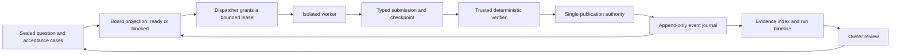

# Research harness pilot specification

**Status.** Design draft for Astra and owner review. Runtime activation and paid work require an explicit profile binding and approval.  
**Primary objective.** Resolve a bounded optimization question and preserve enough evidence for a different person or worker to check, resume, or reject the result.  
**Initial scope.** One question version, one research worker at a time, one deterministic verification service and one publication authority. The pilot uses a fresh run root and starts manually.  
**Inputs.** [Foundation](../../FOUNDATION.md), [legacy audit](../../reports/2026-11-10-restart-audit.md), [source review](../../reports/reading/2026-11-10-research-harness-and-optimization.md), [pilot vocabulary](../GLOSSARY.md#pilot-vocabulary-english).

## 1. Design obligations

| ID | Obligation | Observable failure |
|---|---|---|
| H1 | Specify the scientific question, observation model, comparators, evidence required for each conclusion, and cost ceiling before implementation. Version the specification and acceptance cases separately. | A run cannot explain what result would change the next research decision. |
| H2 | Work by stigmergy. A worker submits typed evidence and a checkpoint. Ready work is derived from these durable signals and approved dependencies. One bounded lease is the right to submit for an attempt. | A second session needs chat history, an instruction from the first worker, or an unscheduled premium call to resume. |
| H3 | Separate generation, verification, and publication by enforceable permissions. A code judge owns scientific transitions and an authenticated human owns attestation and thesis admission. | A worker, spec file, PDF, or UI can trigger a verdict with an untrusted check or an unapproved state change. |
| H4 | Record provenance and enforce append-only history. Published evidence is immutable and every view identifies the source sequence. Rebuilding a projection preserves all records. | Retry changes a cited hash, an old lease writes, or replay loses a knowledge block. |
| H5 | Treat correctness, scope, novelty, relevance, and research disposition separately. Reuse requires scope compatibility and revalidation of stale evidence. | A finite grid becomes a theorem, a proof of a weaker model becomes a result on the source problem, or the number of nodes is used as progress. |
| H6 | Cap authorization, time, tools, and paid spend before execution. Record measured usage and uncertainty separately. Route the least expensive capable worker first. | Missing billing data becomes zero, work continues after exhaustion, or a fallback silently invokes a premium model. |
| H7 | Expose current stage, age, blocker, source of truth, remaining budget, and next action. An unfamiliar owner must be able to trace a result from the board to its evidence. | An absent heartbeat appears as running, missing data appears as success, or a claimed result cannot be inspected. |
| H8 | English for specifications, structured fields, prompts, logs, UI, claims, checkers, and handoffs. Preserve original quotations as source data. Human-facing Russian reports and thesis drafts use a separately curated terminology map. | An internal term has several meanings, a title translation substitutes for evidence, or a Russian rendering silently changes quantifiers. |

Use a new implementation boundary. The pilot is independent of both the legacy research runner and Stigmergy. Treat current PDFs, candidate statements, Lean drafts, and checks as inputs with provenance. A legacy algorithm can become an adapter only after demonstrating the required semantics against the pilot acceptance suite. Preserve historical status as metadata. Importing a claim into the pilot gives it a new version and an explicit review disposition. Keep the old journal and graph separately inspectable.

## 2. Work units and owner experience

| Moment | Owner sees | System behavior |
|---|---|---|
| Preparing a question | One decision, candidate result, closest published comparator, assumptions, expected evidence, capped cost | The lead submits a question specification. An approved item becomes `ready` when declared dependencies resolve. An incomplete item exposes the missing fields. |
| A worker has a lease | Question ID, stage, owner of the lease, last heartbeat, elapsed time, reserved and settled spend, next expected checkpoint | The dispatcher grants one lease for the sealed version. A worker submits a progress signal or artifact scoped to that lease. |
| A check returns | Scoped result, linked witness or log, checker version, remaining work | The trusted verifier reports a typed outcome. An infeasible model, a checker crash, and a counterexample are distinguishable. |
| Work is stuck | Blocker, responsible party, attempted recovery, expected next action | A timeout first reconciles any durable result. A missing source, conflicting checks, expired lease, or depleted budget has its own disposition. |
| Review | Scope, evidence, novelty delta, usefulness disposition | The owner can advance, revise, park or archive the claim in review. Any attestation or policy decision goes through the established decision route. |

Define `question_spec` with `question_id`, `version_digest`, `problem_scope`, `observation_and_timing`, `objective_and_feasibility`, `target_result`, `closest_comparators`, `change_if_true`, `change_if_false`, `minimum_witness`, `falsifier`, `checker_contracts`, `dependencies`, `budget_profile`, `stop_conditions` and `glossary_digest`. A changed assumption, checker, or acceptance rule changes a bound input version. Records from a previous version remain searchable and require explicit reuse.

The first mathematical episode reconstructs a baseline. Lock one exact state measurement at a fixed time. Start with the open-loop benchmark in A4 Example 1. Preserve its reward-maximization polarity and both coefficient transcriptions in the check record. Test two candidate routes on small rational instances with the same constraints, timing and observations. Treat scenario-prefix policies and measurement policies as different objects until equality of values or a realization map is established. For continuous actions or states, a Bellman oracle requires exact reachable-state or value-function treatment with a stated scope. A sampled state grid gives numerical evidence at its declared precision. If a compact baseline is needed first, use a finite action fixture explicitly marked as such. [Legacy audit, problem and oracle scope](../../reports/2026-11-10-restart-audit.md#1-что-за-задача-у-дмитрук).

### Observation contract for the first episode

Fix $r$ before play. Let $a$ be the first control program and let $p$ be the prefix disturbance. The only new observation is $y=F_r(x_0,a,p)$, the exact state at $r$. The second program $b(y)$ is chosen before suffix disturbances. For finite action and disturbance sets with a common set of admissible suffixes, the reference game is

$$
V(r)=\min_a\;\max_{y\in \{F_r(x_0,a,p):p\in W_{0:r}\}}\;\min_b\;\max_{q\in W_{r:T}}\; \bar g(F_{r:T}(y,b,q)).
$$

Here $\bar g$ is the terminal cost extended by $+\infty$ for states outside the terminal set. The reference construction chooses one suffix program per measured state. A separate exhaustive policy check must agree on the finite fixture. For the continuous-action lift, prove the LP reformulation and verify why its observation classes can be fixed before solving. For correlated disturbances, inspect whether the set of admissible suffixes depends on the information available at $r$. The formula with a common $W_{r:T}$ requires its stated assumption.

Public fixtures for this episode use horizon 2, scalar state, $x_0=0$, one measurement at $r=1$, and terminal cost $|x_2|$. Second-stage actions belong to $\{-1,0,1\}$. The expected values were checked by exact enumeration of the finite policies.

| Fixture | Dynamics and paths | Open loop | State measurement | Disturbance prefix |
|---|---|---:|---:|---:|
| Strict gain | $x_1=u_0+w_0$, $x_2=x_1+u_1$, $u_0\in\{-1,0,1\}$, $w_0\in\{-1,1\}$, $w_1=0$ | 1 | 0 | 0 |
| Correlated hidden disturbance | $u_0=0$, $x_1=0$, $x_2=u_1+w_1$, paths $(-1,-1),(1,1)$ | 1 | 1 | 0 |
| Independent hidden disturbance | Same dynamics, all four pairs of $\pm1$ | 1 | 1 | 1 |

The correlated case detects an oracle that gives the controller the hidden first disturbance. The independent case prevents assuming that every information-class difference changes the value. To exercise terminal feasibility, impose $x_2=0$ on the first case. With measurement the policy $u_0=0, u_1=-x_1$ meets it. The open-loop program cannot make both terminal states zero.

The following research question must survive the usefulness review. Example candidate: characterize strict improvement from one fixed or optimally placed measurement in a stated model, including a no-benefit witness and a useful consequence for choosing a policy. S2–S4 are candidate inputs. Basic information monotonicity is a sanity check. S1's old internal formula and the masked wedge are regression cases. S5 is on hold until its precise policy class, closest affine-rule result, and independent check are identified.

## 3. Stigmergy and the publication boundary



- **Ready work.** A board projection computes readiness from one approved question version, known dependencies, registered blockers and available capacity. The worker picks from the permitted set. A signal such as `follow_up_proposed` can make an item visible. Starting a new research question and filing a Bead stay under human control. Human-entered Beads track implementation work and link to the relevant spec or episode.
- **Lease.** The dispatcher issues `episode_id`, `attempt_id`, a monotone `lease_fence`, a deadline, and a manifest digest. The service that accepts a submission compares these fields under the same serialization boundary. A stale worker may keep its own scratch output. The service rejects a stale submission. Once a submission is durably accepted, its provenance survives even if the worker disappears.
- **Typed signals.** Start with `question_sealed`, `lease_granted`, `checkpoint_saved`, `submission_received`, `verification_finished`, `publication_committed`, `blocked`, `attempt_expired`, `budget_exhausted`, `cancellation_recorded` and `owner_disposition_recorded`. Each event carries `schema_version`, an event ID, sequence and chain hash, actor identity, question version, optional attempt and causal event ID, UTC timestamp, and typed payload. A checkpoint contains input digests, completed steps, evidence IDs, unresolved issue and next action. Heartbeats may be coalesced in a separate operational trace retained with the attempt. This trace conveys freshness. The journal determines scientific state.
- **Isolation.** Execute the worker with a disposable scratch root and read-only inputs. A worktree helps review and rebasing. Enforce filesystem and network boundaries at process level. A worker has no trusted-corpus write, validator path write, publication credentials, or holdout read. An allowlisted source fetcher can put bytes in quarantine. A metered model gateway is the sole path for automatic provider calls. The trusted checker receives data and a pinned checker ID. Submissions have no executable import paths. Native execution of third-party code happens in a separate resource-limited environment with no secrets, publication access or default network.
- **Commit point.** Store evidence bytes immutably by SHA-256, then append a verified publication record under one writer. Use the question version as the publication uniqueness key and bind the manifest digest to it. An attempt can publish a bundle of evidence items. Each sealed question version has at most one terminal publication bundle in the pilot. A request with the same identity and digest returns the existing result. A different digest for that key returns a conflict. Recheck the bound judge result, policy version, applicable gates, and cancellation under the append lock. Cancellation that wins before commit prevents publication. Cancellation after commit can stop future work, and any correction appends a superseding event. A crash before append may leave an unreferenced immutable blob. A crash after append is recovered by replay, including a lost response to the client. Detect a partial or corrupt tail and fail closed with the verified prefix preserved for diagnosis. Demonstrate crash consistency of the chosen append implementation before live use. Tail repair requires explicit review.
- **Authority.** The journal stores committed facts about work and evidence, including explicit owner decisions. A read model (SQLite plus local HTML) is replaceable and read-only to consumers. Blob storage is the source for evidence bytes, the journal for published membership and provenance, the versioned glossary for language, and Beads for owner-maintained tasks. Existing charter controls remain authoritative. A pilot reading or replay session can run without publishing science. The existing reading gate and theory-first decision still apply to the current project. Changing their scope for live publication requires an explicit owner decision.

**Formal contract.** The [TLA+ model](../../specs/research-pilot/PilotPublication.tla) checks a bounded abstraction of one sealed version, two possible workers, two lease attempts, pre-commit cancellation, authorization, budget for attempts and projection replay. It assumes a trusted verifier and a durable append, abstracts evidence admissibility to a Boolean, and has weak fairness only for replay. Source validity, model-call spend, OS isolation, mathematical truth and implementation correctness require their own checks. Require implementation traces and fault injection to establish correspondence for lease, commit, cancellation and replay. Model multiple versions or concurrent publication domains before permitting them.

For structured records, validate term IDs against the glossary version in the sealed input. Use the canonical labels in generated views. Preserve original quotations as a separate field. A Russian rendering requires a terminology and quantifier review against the English claim.

## 4. Scientific usefulness and evidence

A proposition can be precise and verifiable while leaving the active question untouched. Use the following decisions independently.

| Axis | Required record | Authority |
|---|---|---|
| Scientific scope and validity | Immutable statement and assumptions, explicit quantifiers and policy information, checked witness or certificate and covered domain | Registered deterministic judge for a numerical transition. Pinned Lean declaration, axiom policy, and statement correspondence for central formal claims. |
| Novelty | Closest claims, source pages, assumptions compared, residual difference and unresolved collisions. An empty search has a bounded scope. | Scout proposes. Owner accepts the research positioning. |
| Usefulness | Named consumer or decision, executable comparison, consequence if true and if false, transfer conditions, cost of the next discriminating test | Lead proposes `core_candidate`, `supporting`, `regression_only` or `archive`. Owner sets disposition. |
| Reuse | Domain fingerprint, dependency edges, last independent check, relevance to the current question, invalidation reason | Retrieval filters evidence and exposes incompatible analogies. Invalidation creates a visible review obligation. |

A decision packet fits on one screen before optional evidence. It contains **claim, scope, closest comparator, change to the research decision, evidence or blocker, next test and cap**. A candidate without a falsifier or discriminating test is deferred. A known result can be accepted as a reproduction fixture. A certified counterexample can be useful if it narrows a family or changes the choice of policy. A numerical success can remain supporting evidence with the grid and oracle shown. A proof about a different object fails the scope check even if Lean succeeds. Report these axes separately. The owner decides whether the result is worth a chapter.

Certificates and checker output include `statement_digest`, `scope_digest`, `input_digest`, `checker_digest`, `coverage`, result enum and artifact digest. The checker binds the claim to the executable assertion before testing. Require independent witness replay, or a different mathematical route where equivalence is claimed. Two solvers sharing a faulty formulation can agree for the wrong reason. Compare LP and Bellman on independently transcribed models. The requirement for 2–3 core Lean results comes from FOUNDATION and applies to the eventual thesis.

## 5. Memory and literature

| Layer | Save | How to use |
|---|---|---|
| Source discovery | DOI/arXiv/repository revision, query and date, deduplicated lead, why relevant | Leads for reading. Title, abstract and embeddings have retrieval value only. |
| Research evidence | Source document digest and page, verified excerpt or proof reference, scoped claim, conditions, polarity, relations and revision | Retrieve using question and scope constraints before semantic similarity. Return original evidence IDs and nearby negative results. |
| Episodes | Checkpoint, manifest, role/model bindings, commands and outputs or content hashes, costs, failure classification, useful outcome | Resume from a stable checkpoint. Compare episodes before changing a method. |
| Reusable methods | Method candidate, originating episodes, conditions, reproducible benefit, independent review and version | Promote a workflow rule only after evidence and a regression. Invalidating a method leaves old episodes reproducible. |
| Raw traces | Minimal process telemetry, with redaction and retention distinct from scientific evidence | Debug within a limited window. A transcript has no authority to change policy or certify facts. |

Implement indexed search over typed records before investing in embeddings. A context packet starts from the sealed question and includes glossary version, positive and negative evidence, closest comparators, remaining unknowns and the precise next step. Report why each item was selected. A theorem with incompatible assumptions can be shown as an analogy if explicitly labeled. A new source or checker can invalidate dependent conclusions through `depends_on`, `contradicts`, `specializes`, `supersedes`, and `reproduces`. Generate views from these records.

Scope each search to the next scientific decision. Use bibliography and forward citations from A2/A4 and their successors, Math-Net and publisher sources, OpenAlex/arXiv/Optimization Online, and public code repositories. For the first episode, run bounded queries about state/output measurements, observation scheduling and decision-dependent information discovery. Search AI-math repositories separately for methods and reproducibility artifacts. Adopt an existing algorithm only when its assumptions and license are identified and a replay succeeds. A missing paper is a visible blocker if the result depends on it. Stop a search with a query/date log and a bounded conclusion, such as “no equivalent found among these sources”. See the [prior-art and systems scan](../../reports/reading/2026-11-10-research-harness-and-optimization.md).

## 6. Role routing and budgets

The [draft profile](../../specs/research-pilot/pilot.example.yaml) contains proposed ceilings. Use code for ready-work resolution, deduplication, bound checks, deterministic verification, replay and rendering. Use one worker slot. GPT-6 Luna is a candidate for extraction and structured proposals. GPT-6.1 Sol is a candidate for mathematical coding and falsifier construction. Calibrate the routes on the same sealed episodes before selecting a binding. [OpenAI model selection](https://developers.openai.com/api/docs/guides/model-selection). Astra handles the initial review of the specification and unresolved scientific forks that include competing explanations, checked evidence, an exact question, and the expected decision. The draft profile reserves one manual Astra review per pilot. A model can draft a verifier or Lean file in scratch. An independent approved checker owns the scientific transition. The owner decides usefulness and attestation.

The draft starts at **one active question, one worker slot, one paid request in flight, up to three runs, at most USD 5 for metered work in the pilot and USD 1.50 per run**. It limits premium work further. The model bindings are deliberately unset pending the owner's account and budget selection. Keep the declared provider policy from FOUNDATION. Before a paid call, reserve a conservative maximum in integer cents using the pinned binding, current tariff, enforceable input/output caps, and tool charges. Include system instructions, tool schema and reasoning tokens in the applicable billable limits. Charge against both run and pilot budgets. Settle from provider usage. If usage or billing is unknown, keep the reservation and stop the automatic paid route until reconciled. Manual spend without usage remains explicitly unmetered. Refuse execution if the configuration is draft, unbound or unavailable. Escalation and provider selection require an explicit route.

The profile also caps wall time, number of tools, calls, attempts, and literature intake. The watchdog is deterministic and reports `blocked`, `expired`, `canceled` or `budget_exhausted` with the evidence saved so far. After at most two unexplained discrepancies use the FOUNDATION dossier route. Stop the pilot after two consecutive runs with no new usable evidence or resolved decision. That pilot stop is additional to the legacy evaluator thresholds. Manual review decides whether a wider experiment is worth another budget. Launch the pilot on demand.

## 7. Observability contract

Make the board and dossier acceptance surfaces before enabling paid automation. Use a generated local, read-only view with a monotonically increasing projection sequence within a journal lineage. Include the verified source sequence, generation time, clock zone on display, lease/heartbeat age, and a visible stale or incomplete state. The dashboard should answer four questions in under a minute for an unfamiliar owner.

| Question | Display and source |
|---|---|
| What is active, and why? | One question/version, stage, input and expected output, next permitted transition and reason for the lease. Derived from structured events and persisted checkpoint. |
| What is blocking progress? | Reading, budget, rights, verification, recovery, or owner decision, with evidence and next action. `Idle`, `blocked`, `lease expired`, and `telemetry unavailable` render distinctly. |
| What did the last run produce? | Timeline by `episode_id` and `attempt_id`, start/check/commit/replay links, evidence and checksums, scope, owner disposition, exact state after restart. Legacy events without reliable IDs stay in a separate history view. |
| What did it cost and was it useful? | Settled vs reserved vs unknown, wall time, time in stages and retries, cost per accepted packet, human review time and agreed next step. A zero denominator is “no accepted packets yet”. |

Minimum events support a timeline waterfall, retry and timeout markers, provenance drill-down, and one board row per question version. The first acceptance surface is a readable board and dossier. The current `process.html` is a historical export. The existing evaluator groups events into serial windows and does not establish present run state. See [evaluator](../../src/aro/evaluator.py#L86) and [site generator](../../src/aro/sitegen.py#L126).

Operational alerts are transitions with reason and action. Group ready decision packets for review. Publication invariant breaches, unknown spend that blocks work, and explicit owner decisions need visible attention. For the local pilot, support a quick status read and deterministic regeneration by CLI. Hold the last verified view during recovery, and label its age until replay catches up. Test initial empty state, crash/replay, skipped runs, and missing telemetry in the same view.

## 8. Acceptance and sequence for Astra

Use SDD. A signed-off question and versioned contracts precede code. Keep small reviewable slices, each independently runnable on a fixture. Use the public regression suite during development and a separately owned holdout for release. The holdout contains the private fixtures and expected outcomes. A worker sees the interface and example cases. The evaluator controls holdout access. Tool schemas, infrastructure and assertions are versioned together for a release.

| Slice | Deliverable and acceptance | Dependency |
|---|---|---|
| A. Scope and boundaries | Pick the initial published anchor and exact finite baseline. Produce the approved contract, source-page comparisons, baseline choices, term IDs and an immutable input bundle. A reader can tell which research conclusion each outcome changes. | First. A mathematical novelty assertion is optional at this stage. |
| B. Local control plane | New run root, narrow dispatcher and publisher, pinned checker registry, validated profile, event reducer. Conformance cases follow the TLA+ actions, including expired fence, abort before/after commit, unknown response and replay. | Design B against this spec. Stub output on a toy fixture is sufficient before science integration. |
| C. Board and memory | Rebuild projection from scratch, compare complete logical state and content digests, render active/blocked/terminal states, show a resume packet consumed by a fresh worker. Include stale/legacy views. | B. Paid runs follow C and the release gate. |
| D. Scientific tracer | Two independent model paths for the exact, stated problem, direct policy realization check, one published anchor, and a useful negative case. A mismatched observation class or coefficient must fail. | A. Can develop offline in parallel with B/C as independent work. |
| E. Release gate | Replay supplied episodes and hidden cases, fault-inject at artifact/write/append/projection boundaries, and verify cost reservations and OS boundaries. Reject generated artifacts that only pass their self-authored checker. | B–D. Owner reviews the checkpoint. |
| F. Paid calibration | Compare a manual baseline with one capped worker route. Save the decision packet, exact bill or unknown reservation, checkpoint and evidence. Review whether output changes the next decision and how long the owner needed to review it. | E and explicit runtime configuration and spend approval. |

**Public regressions.** The execution suite tests authorization, empty grids, malformed certificates and mismatched PDF pages. The recovery suite tests duplicate requests, stale leases, cancellation before and after commit, crashes across the append boundary, corrupt tails, unknown billing, and lost projections. The scientific suite tests observation semantics, ignored dynamics, shared epigraphs, wrong formal statements, and incompatible prior evidence.

**Hidden episode families.** A correct scoped reproduction, a false transfer with a concealed witness, a plausible but already-known or irrelevant result, a new worker resuming from a checkpoint, and release faults affecting permission, budget, or recovery. Seal inputs, expected evidence, protected fixture ownership and release criteria before running. For deterministic public and private invariant checks, any violation blocks release. For an affordable stochastic screen, preselect cases and use two independent runs per case when the run cap covers the pair. Evaluation uses isolated clones of a sealed input with separate run namespaces. Report cases that succeed on both runs (`pass^2`), raw denominators and exact spend per accepted packet. This estimates only the screened cases. The default three-run profile can fund one such pair and a separate single run. A wider paired comparison needs its own budget. Baselines share inputs and access permissions. Record harness version, model binding, seeds where supported, outcome, policy violations, review time and costs. Count skipped and exhausted cases separately. A technically valid negative result counts if it resolves the predefined decision.

**Pilot completion.** A fresh worker can reconstruct and resume the sealed episode from durable evidence. The owner can reproduce or reject one packet that resolves the predefined research decision. The board exposes the decision, evidence, blocker if any, and settled or reserved cost. Acceptance also requires all deterministic invariants and the agreed cost ceiling. A completed baseline establishes a reference method. Treat a proposed thesis contribution as a separate owner decision.

**Astra handoff.** Return an English implementation spec, dependency-ordered small work packets, ownership and file boundaries, the acceptance interface, budget behavior, and open owner forks. For each packet specify what makes it independently reviewable and what can be reverted. Estimates refer to bounded agent work and paid calls. Record approved owner decisions through the established ledger. Use the [owner briefing](../../reports/briefings/2026-11-10-astra-restart.md) for first actions.

## 9. Checks performed on this draft

TLC 2.19 explored 94 distinct reachable states in the bounded model and found no violation of the configured invariants or replay property. Enabling stale submission yielded an expired-fence trace. Enabling gate bypass yielded an unauthorized publication trace. Four finite control cases agreed between policy enumeration and the measured-state Bellman calculation. The correlated case distinguishes the state-measurement value of 1 from the disturbance-prefix value of 0. A separate exact rational certificate gives 1.495710098124 on the printed A4 coefficients and 1.501101989382 on the reconstructed coefficients. The latter rounds to the published 1.501102. The coefficient reconstruction is an inference. [Benchmark provenance](../../reports/reading/2026-11-10-research-harness-and-optimization.md#reproduction-of-the-a4-open-loop-baseline). [Check record](../../artifacts/research-pilot/2026-11-10-pilot-checks.txt), SHA-256 `aa6be8719fcd2ba8bf850c1858adca2a0fb6833810a0ba0709b7bb395b6a5189`.

From the repository root, use the installed TLC jar and a temporary working directory for model checking. To reproduce a negative case, change only the corresponding boolean in the copied config. Both negative runs should exit 12 with the invariant reported in the check record.

```sh
python3 specs/research-pilot/check_observation_fixtures.py
python3 specs/research-pilot/check_dmitruk_open_loop.py
work=$(mktemp -d)
cp specs/research-pilot/PilotPublication.tla specs/research-pilot/PilotPublication.cfg "$work/"
(
  cd "$work"
  java -cp "$HOME/.local/share/tlaplus/tla2tools.jar" tlc2.TLC -workers 1 PilotPublication
)
```

These checks cover the model and public finite fixtures. Implementation conformance, the protected release holdout, paid-run economics, and the proof of any new mathematical result are future acceptance work.
