# Фундаментальный математический атлас: ОГУ <-> двухэтапная ARO, точность ADR и выбор расписания замыканий

> Автоматически сгенерировано из [atlas.json](atlas.json) скриптом [build_atlas.py](build_atlas.py). Проверка целостности и живого ядра Lean 4: `make verify-atlas` ([verify_atlas.py](verify_atlas.py)).
> Связанный Lean 4 Blueprint: [BLUEPRINT.md](../../verification/lean/blueprint/BLUEPRINT.md) и учебный пакет для LearnHarness: [02-math-atlas](../guides/02-math-atlas/01-intuition-and-map.md).

## 1. Сводка Атласа

| Метрика | Значение |
|---|---|
| Всего узлов в графе | **37** |
| Направленных связей (DAG) | **60** |
| Доказано в Lean 4 (`lean_proved`) | **16 узлов (55 живых деклараций)** |
| Проверено точными оракулами (`oracle_verified`) | **8** |
| Контрпримеры / границы (`falsified`) | **8** |
| Открытые гипотезы и цели обобщения (`open`) | **5** |

Распределение по типам узлов: Предпосылка (`axiom_assumption`): **1**, Контрпример (`counterexample`): **9**, Определение (`definition`): **4**, Цель обобщения (`generalization_target`): **2**, Лемма (`lemma`): **3**, Открытая гипотеза (`open_conjecture`): **4**, Теорема (`theorem`): **14**.

## 2. Граф зависимостей и исследовательской границы (Mermaid DAG)

```mermaid
flowchart TD
    def_ogu_system["def-ogu-system (lean_proved)"]
    ax_fixed_recourse_box["ax-fixed-recourse-box (oracle_verified)"]
    def_exogenous_deviation["def-exogenous-deviation (lean_proved)"]
    def_borel_policies["def-borel-policies (lean_proved)"]
    def_future_support["def-future-support (lean_proved)"]
    thm_f1_expansion["thm-f1-expansion (lean_proved)"]
    thm_f2_policy_bijection["thm-f2-policy-bijection (lean_proved)"]
    thm_f2_epigraph_equality["thm-f2-epigraph-equality (lean_proved)"]
    thm_f3_future_tightening["thm-f3-future-tightening (lean_proved)"]
    lem_p1_l1_rotation["lem-p1-l1-rotation (lean_proved)"]
    lem_p2_info_monotone["lem-p2-info-monotone (lean_proved)"]
    thm_p3_1d_adr_exactness["thm-p3-1d-adr-exactness (lean_proved)"]
    thm_transfer_a4_v1["thm-transfer-a4-v1 (oracle_verified)"]
    thm_m0_finite_bellman["thm-m0-finite-bellman (oracle_verified)"]
    lem_wave5_support_bound["lem-wave5-support-bound (oracle_verified)"]
    thm_t1_bridge_exact["thm-t1-bridge-exact (oracle_verified)"]
    thm_t6_box_static_exact["thm-t6-box-static-exact (oracle_verified)"]
    thm_t7_simplex_exact["thm-t7-simplex-exact (oracle_verified)"]
    ce_d1_prefix_merge["ce-d1-prefix-merge (falsified)"]
    ce_d2_pairwise_vs_joint["ce-d2-pairwise-vs-joint (falsified)"]
    ce_e_rank1_singleton["ce-e-rank1-singleton (falsified)"]
    ce_as1_rank2_separable["ce-as1-rank2-separable (oracle_verified)"]
    ce_t2_soc_temporal["ce-t2-soc-temporal (falsified)"]
    ce_t3_chen_zhang["ce-t3-chen-zhang (falsified)"]
    ce_t4_gtw25_cond_b["ce-t4-gtw25-cond-b (falsified)"]
    ce_t5_beg18_separating["ce-t5-beg18-separating (falsified)"]
    conj_f4_vertex_lp_selector["conj-f4-vertex-lp-selector (lean_proved)"]
    conj_o4_closure_scheduling["conj-o4-closure-scheduling (open)"]
    conj_o1_adr_exactness_char["conj-o1-adr-exactness-char (open)"]
    conj_o8_quantifier_gap["conj-o8-quantifier-gap (open)"]
    gen_multistage_k_closures["gen-multistage-k-closures (open)"]
    gen_nonbox_conic_uncertainty["gen-nonbox-conic-uncertainty (open)"]
    ce_o8_sion_gap["ce-o8-sion-gap (falsified)"]
    thm_g2_conic_support["thm-g2-conic-support (lean_proved)"]
    thm_o4_single_closure_value["thm-o4-single-closure-value (lean_proved)"]
    thm_g1_multistage_bridge["thm-g1-multistage-bridge (lean_proved)"]
    thm_o1_adr_simplex_1d_2d["thm-o1-adr-simplex-1d-2d (lean_proved)"]
    def_exogenous_deviation -->|depends_on| def_ogu_system
    def_exogenous_deviation -->|depends_on| ax_fixed_recourse_box
    def_borel_policies -->|depends_on| def_exogenous_deviation
    def_future_support -->|depends_on| def_ogu_system
    def_future_support -->|depends_on| ax_fixed_recourse_box
    thm_f1_expansion -->|depends_on| def_ogu_system
    thm_f1_expansion -->|depends_on| def_exogenous_deviation
    thm_f2_policy_bijection -->|depends_on| thm_f1_expansion
    thm_f2_policy_bijection -->|depends_on| def_borel_policies
    thm_f2_epigraph_equality -->|depends_on| thm_f2_policy_bijection
    thm_f3_future_tightening -->|depends_on| thm_f2_epigraph_equality
    thm_f3_future_tightening -->|depends_on| def_future_support
    thm_p3_1d_adr_exactness -->|depends_on| lem_p1_l1_rotation
    lem_p2_info_monotone -.->|related_gap| def_ogu_system
    thm_transfer_a4_v1 -->|special_case_of| thm_f3_future_tightening
    thm_m0_finite_bellman -->|depends_on| lem_p2_info_monotone
    lem_wave5_support_bound -->|depends_on| thm_f3_future_tightening
    lem_wave5_support_bound -->|depends_on| lem_p2_info_monotone
    thm_t1_bridge_exact ==>|generalizes| thm_p3_1d_adr_exactness
    thm_t6_box_static_exact -->|depends_on| ax_fixed_recourse_box
    thm_t7_simplex_exact -->|depends_on| ax_fixed_recourse_box
    ce_d1_prefix_merge -->|depends_on| thm_m0_finite_bellman
    ce_d2_pairwise_vs_joint ==>|generalizes| ce_d1_prefix_merge
    ce_e_rank1_singleton -.->|related_gap| ce_d2_pairwise_vs_joint
    ce_as1_rank2_separable ==>|generalizes| ce_e_rank1_singleton
    ce_as1_rank2_separable -.->|related_gap| ce_d2_pairwise_vs_joint
    ce_t2_soc_temporal -->|depends_on| ax_fixed_recourse_box
    ce_t3_chen_zhang -->|depends_on| ax_fixed_recourse_box
    ce_t4_gtw25_cond_b -->|depends_on| ax_fixed_recourse_box
    ce_t5_beg18_separating -->|depends_on| ax_fixed_recourse_box
    conj_f4_vertex_lp_selector -.->|open_gap| thm_f3_future_tightening
    conj_f4_vertex_lp_selector ==>|generalizes| thm_transfer_a4_v1
    conj_o4_closure_scheduling -.->|open_gap| lem_wave5_support_bound
    conj_o4_closure_scheduling -->|depends_on| thm_m0_finite_bellman
    conj_o1_adr_exactness_char -.->|open_gap| thm_t1_bridge_exact
    conj_o1_adr_exactness_char ==>|generalizes| thm_t6_box_static_exact
    conj_o1_adr_exactness_char ==>|generalizes| thm_t7_simplex_exact
    ce_t2_soc_temporal -.->|refutes| conj_o1_adr_exactness_char
    ce_t3_chen_zhang -.->|refutes| conj_o1_adr_exactness_char
    ce_t4_gtw25_cond_b -.->|refutes| conj_o1_adr_exactness_char
    ce_t5_beg18_separating -.->|refutes| conj_o1_adr_exactness_char
    conj_o8_quantifier_gap -.->|open_gap| thm_f2_epigraph_equality
    conj_o8_quantifier_gap -->|depends_on| lem_p2_info_monotone
    gen_multistage_k_closures ==>|generalizes| thm_f3_future_tightening
    gen_multistage_k_closures -.->|open_gap| conj_f4_vertex_lp_selector
    ce_d1_prefix_merge -.->|refutes| gen_multistage_k_closures
    ce_d2_pairwise_vs_joint -.->|refutes| gen_multistage_k_closures
    gen_nonbox_conic_uncertainty ==>|generalizes| thm_f3_future_tightening
    ce_t2_soc_temporal -.->|constrains_adr| gen_nonbox_conic_uncertainty
    ce_t3_chen_zhang -.->|constrains_adr| gen_nonbox_conic_uncertainty
    ce_o8_sion_gap -.->|related_gap| conj_o8_quantifier_gap
    thm_g2_conic_support ==>|generalizes| thm_f3_future_tightening
    thm_g2_conic_support -->|special_case_of| gen_nonbox_conic_uncertainty
    thm_o4_single_closure_value -->|depends_on| conj_f4_vertex_lp_selector
    thm_o4_single_closure_value -->|special_case_of| conj_o4_closure_scheduling
    thm_g1_multistage_bridge ==>|generalizes| thm_f2_epigraph_equality
    thm_g1_multistage_bridge -->|special_case_of| gen_multistage_k_closures
    thm_o1_adr_simplex_1d_2d ==>|generalizes| thm_p3_1d_adr_exactness
    thm_o1_adr_simplex_1d_2d -->|depends_on| conj_f4_vertex_lp_selector
    thm_o1_adr_simplex_1d_2d -->|special_case_of| conj_o1_adr_exactness_char
```

## 3. Карта узлов по доменам

### Фундамент и предпосылки

| Узел | Тип | Статус | Краткое содержание | Машинная опора |
|---|---|---|---|---|
| `def-ogu-system` | Определение | Доказано в Lean 4 | Линейная дискретная система гарантированного управления (BridgeFormalV2.Data) | Lean 4: `BridgeFormalV2.Proofs.nonempty_blocks` |
| `ax-fixed-recourse-box` | Предпосылка | Проверено точным оракулом | Предпосылки модели: фиксированный рекурс, боксовое возмущение и измеримость по Борелю | Оракул: `research/claims/bridge-transfer-v1/check.py` |
| `def-exogenous-deviation` | Определение | Доказано в Lean 4 | Экзогенное множество префиксных отклонений Xi = L(W^r) | Lean 4: `BridgeFormalV2.Proofs.exogenous_image` |
| `def-borel-policies` | Определение | Доказано в Lean 4 | Borel-политики по состоянию ОГУ и экзогенные правила ARO | Lean 4: `BridgeFormalV2.Proofs.observation_fibre` |
| `def-future-support` | Определение | Доказано в Lean 4 | Направленная опорная функция будущего возмущения и суженные строки ARO | Lean 4: `BridgeFormalV3.Proofs.attained_support` |

### Ядро моста ОГУ <-> ARO (F1-F4)

| Узел | Тип | Статус | Краткое содержание | Машинная опора |
|---|---|---|---|---|
| `thm-f1-expansion` | Теорема | Доказано в Lean 4 | F1: Точное хронологическое раскрытие линейной динамики и разложение на префикс и суффикс | Lean 4: `BridgeFormalV2.Proofs.expansion`, `BridgeFormalV2.Proofs.prefix_split`, `BridgeFormalV2.Proofs.source_chronology`, `BridgeFormalV2.Proofs.suffix_expansion` |
| `thm-f2-policy-bijection` | Теорема | Доказано в Lean 4 | F2a: Прямой и обратный перевод Borel-политик ОГУ <-> двухэтапная ARO | Lean 4: `BridgeFormalV2.Proofs.forward_policy`, `BridgeFormalV2.Proofs.reverse_policy` |
| `thm-f2-epigraph-equality` | Теорема | Доказано в Lean 4 | F2b: Точное равенство множеств epigraph-уровней (sourceLevels = aroLevels) | Lean 4: `BridgeFormalV2.Proofs.epigraph_equality` |
| `thm-f3-future-tightening` | Теорема | Доказано в Lean 4 | F3: Точное исключение будущих возмущений w^+ через опорные функции бокса | Lean 4: `BridgeFormalV3.Proofs.future_expansion`, `BridgeFormalV3.Proofs.robust_row`, `BridgeFormalV3.Proofs.exact_tightening` |
| `thm-transfer-a4-v1` | Теорема | Проверено точным оракулом | Точный рациональный перенос ОГУ -> ARO на экземплярах A4 Дмитрук (r=67, r=104) | Оракул: `research/claims/bridge-transfer-v1/check.py`, `verification/oracles/wave4-a4-closures/check.py` |
| `conj-f4-vertex-lp-selector` | Открытая гипотеза | Доказано в Lean 4 | F4: Конечная вершинная LP-редукция и измеримый Borel-селектор на зонотопе Xi = L(W^r) | Lean 4: `AroProofs.BridgeF4VertexLP.borel_right_inverse_exists`, `AroProofs.BridgeF4VertexLP.vertex_lp_to_aro`, `AroProofs.BridgeF4VertexLP.vertex_lp_epigraph_eq_aro`, `AroProofs.BridgeF4VertexLP.vertex_lp_epigraph_eq_source`, `AroProofs.BridgeF4VertexLP.zonotopeVertices_finite`, `AroProofs.BridgeF4VertexLP.extreme_vertex_lp_to_aro`, `AroProofs.BridgeF4VertexLP.extreme_vertex_lp_epigraph_eq_aro`, `AroProofs.BridgeF4VertexLP.extreme_vertex_lp_epigraph_eq_source`, `AroProofs.BridgeF4VertexLP.extreme_vertex_lp_eq_corner_lp`; Оракул: `research/claims/bridge-transfer-v1/check.py`, `verification/oracles/exact_lp.py`, `verification/falsifiers/run01/falsify_f4.py` |

### Точность аффинных правил (ADR / P1-P3 / T1-T7)

| Узел | Тип | Статус | Краткое содержание | Машинная опора |
|---|---|---|---|---|
| `lem-p1-l1-rotation` | Лемма | Доказано в Lean 4 | P1: Тождества поворота L1-нормы в 2D мост-классе | Lean 4: `AroProofs.Aroform.l1_eq_max_sum_diff`, `AroProofs.Aroform.l2a_diff_two_path`, `AroProofs.Aroform.l2a_sum_two_path` |
| `thm-p3-1d-adr-exactness` | Теорема | Доказано в Lean 4 | P3: Точность аффинного хордового правила в одномерной задаче рекурса | Lean 4: `AroProofs.Aroform.one_d_exactness`; Оракул: `verification/falsifiers/battery_t1_t7.py` |
| `thm-t1-bridge-exact` | Теорема | Проверено точным оракулом | T1: Точность аффинного правила в 1D и 2D мост-классе на вершинах куба | Оракул: `verification/falsifiers/battery_t1_t7.py` |
| `thm-t6-box-static-exact` | Теорема | Проверено точным оракулом | T6: Покомпонентная боксовая неопределённость (статика = ADR = ARO) | Оракул: `verification/falsifiers/battery_t1_t7.py` |
| `thm-t7-simplex-exact` | Теорема | Проверено точным оракулом | T7: Точность линейных/аффинных правил на симплексе Delta_2 | Оракул: `verification/falsifiers/battery_t1_t7.py` |
| `conj-o1-adr-exactness-char` | Открытая гипотеза | Открытая гипотеза / цель | O1: Проверяемое необходимое и достаточное условие точности ADR за пределами M1–M2 | Оракул: `verification/falsifiers/battery_t1_t7.py` |
| `thm-o1-adr-simplex-1d-2d` | Теорема | Доказано в Lean 4 | O1 (частично): точность ADR на симплексе, барицентрические сизигии T3 и дихотомия 1D против 2D в BridgeFormalV2 | Lean 4: `AroProofs.BridgeO1ADRExactness.static_subset_adr_subset_aro`, `AroProofs.BridgeO1ADRExactness.adr_exact_on_simplex`, `AroProofs.BridgeO1ADRExactness.barycentric_syzygy_adr_coupling`, `AroProofs.BridgeO1ADRExactness.chen_zhang_t3_adr_gap`, `AroProofs.BridgeO1ADRExactness.bridge_adr_subset_aro_and_source`, `AroProofs.BridgeO1ADRExactness.bridge_adr_exact_1d`, `AroProofs.BridgeO1ADRExactness.exists_bridge_2d_strict_adr_gap`; Оракул: `verification/falsifiers/run01/falsify_o1.py` |

### Ценность информации и выбор расписания R (O4, O8)

| Узел | Тип | Статус | Краткое содержание | Машинная опора |
|---|---|---|---|---|
| `lem-p2-info-monotone` | Лемма | Доказано в Lean 4 | P2: Антимонотонность инфимума sInf на подмножествах Set ENNReal | Lean 4: `AroProofs.Aroform.info_value_monotone` |
| `thm-m0-finite-bellman` | Теорема | Проверено точным оракулом | Точный конечный оракул Беллмана M0 (политики по состоянию и по префиксу) | Оракул: `verification/oracles/m0/pilot/checkers/finite_bellman.py`, `verification/oracles/m0/pilot/baseline/finite_reference.py` |
| `lem-wave5-support-bound` | Лемма | Проверено точным оракулом | Двойственная верхняя оценка ценности информации Wave-5 (J <= V_0 <= V_r <= D_0 + Delta) | Оракул: `research/claims/wave5-support-bound/verification/check.py` |
| `conj-o4-closure-scheduling` | Открытая гипотеза | Открытая гипотеза / цель | O4: Критерий строгой ценности измерения и выбор оптимального расписания замыканий R | Оракул: `verification/oracles/m0/pilot/checkers/finite_bellman.py`, `research/claims/wave5-support-bound/verification/check.py` |
| `conj-o8-quantifier-gap` | Открытая гипотеза | Открытая гипотеза / цель | O8: Зазор порядка квантификаторов minimax против maximin (V(R) - V_mm) | Оракул: `research/counterexamples/O8-sion-gap/checks/check_o8_gap.py`, `verification/oracles/exact_lp.py`, `verification/oracles/m0/pilot/checkers/finite_bellman.py` |
| `thm-o4-single-closure-value` | Теорема | Доказано в Lean 4 | O4 (одно замыкание): критерий строгого выигрыша от измерения и машинный свидетель разрыва 4 > 2 | Lean 4: `AroProofs.BridgeO4ClosureValue.openLoop_subset_aro`, `AroProofs.BridgeO4ClosureValue.openLoop_subset_source`, `AroProofs.BridgeO4ClosureValue.zero_gain_of_unconstrained_terminal`, `AroProofs.BridgeO4ClosureValue.zero_gain_of_prefix_in_terminal_kernel`, `AroProofs.BridgeO4ClosureValue.openLoop_eq_shared_corner_lp`, `AroProofs.BridgeO4ClosureValue.strict_gain_iff_corner_separation`, `AroProofs.BridgeO4ClosureValue.exists_strict_value_of_measurement_gap`; Оракул: `verification/falsifiers/run01/falsify_o4.py` |

### Границы и контрпримеры (D1-D2, E, A-S1, T2-T5)

| Узел | Тип | Статус | Краткое содержание | Машинная опора |
|---|---|---|---|---|
| `ce-d1-prefix-merge` | Контрпример | Опровергнуто / контрпример | Контрпример D1: слияние префиксов строго ухудшает значение политик по состоянию | Оракул: `research/counterexamples/D1-baseline/checks/check_candidate_v2.py` |
| `ce-d2-pairwise-vs-joint` | Контрпример | Опровергнуто / контрпример | Контрпример D2: попарная совместимость префиксов не влечёт совместную совместимость | Оракул: `research/counterexamples/D2-structured/checks/certificate_check_v2.py`, `research/counterexamples/D2-structured/checks/trajectory_check_v2.py` |
| `ce-e-rank1-singleton` | Контрпример | Опровергнуто / контрпример | Контрпример E: пустое множество продолжений в одноэлементной ячейке (rank(L) <= 1) | Оракул: `research/counterexamples/E-rank1/checks/rank_one_check.py` |
| `ce-as1-rank2-separable` | Контрпример | Проверено точным оракулом | Проба Astra A-S1: достаточность попарной совместимости в покоординатно-разделимом подклассе rank(L) = 2 | Оракул: `research/counterexamples/astra-probe-AS1/checks/check.py` |
| `ce-t2-soc-temporal` | Контрпример | Опровергнуто / контрпример | Контрпример T2: SOC временная сеть Сюй-Бюрера на евклидовом шаре (зазор Omega(s) для полной матрицы ADR) | Оракул: `verification/falsifiers/battery_t1_t7.py` |
| `ce-t3-chen-zhang` | Контрпример | Опровергнуто / контрпример | Контрпример T3: полиэдральный кросс-политоп Чэня-Чжана N-против-1 (ADR=3 против ARO=EAARC=1) | Оракул: `verification/falsifiers/battery_t1_t7.py` |
| `ce-t4-gtw25-cond-b` | Контрпример | Опровергнуто / контрпример | Контрпример T4: нарушение условия (B) теоремы GTW25 (3/2 против 5/4) | Оракул: `verification/falsifiers/battery_t1_t7.py` |
| `ce-t5-beg18-separating` | Контрпример | Опровергнуто / контрпример | Контрпример T5: разделяющее семейство BEG18 (m=900, зазор Omega(sqrt(m))) | Оракул: `verification/falsifiers/battery_t1_t7.py` |
| `ce-o8-sion-gap` | Контрпример | Опровергнуто / контрпример | Контрпример O8: строгий зазор порядка квантификаторов V({1})=2 > 0=V_mm на 1D-системе | Оракул: `research/counterexamples/O8-sion-gap/checks/check_o8_gap.py` |

### Естественные обобщения (G1-G2)

| Узел | Тип | Статус | Краткое содержание | Машинная опора |
|---|---|---|---|---|
| `gen-multistage-k-closures` | Цель обобщения | Открытая гипотеза / цель | G1: Обобщение моста ОГУ <-> многоэтапная ARO на k >= 2 замыканий | Оракул: `verification/oracles/m0/pilot/checkers/finite_bellman.py`, `research/counterexamples/D1-baseline/checks/check_candidate_v2.py`, `research/counterexamples/D2-structured/checks/trajectory_check_v2.py` |
| `gen-nonbox-conic-uncertainty` | Цель обобщения | Открытая гипотеза / цель | G2: Обобщение сужения F3 на произвольные компактные выпуклые и конические множества W_t | Оракул: `verification/falsifiers/battery_t1_t7.py`, `verification/falsifiers/sympy_counterexample_template.py` |
| `thm-g2-conic-support` | Теорема | Доказано в Lean 4 | G2 (прямое сужение): точное исключение будущего шума на компактных и конических W_t и неполиэдральность 2D-круга | Lean 4: `AroProofs.BridgeG2ConicSupport.general_attained_support`, `AroProofs.BridgeG2ConicSupport.general_robust_row`, `AroProofs.BridgeG2ConicSupport.general_exact_tightening`, `AroProofs.BridgeG2ConicSupport.box_support_eq_f3`, `AroProofs.BridgeG2ConicSupport.l1_cross_polytope_support`, `AroProofs.BridgeG2ConicSupport.l2_soc_ball_support`, `AroProofs.BridgeG2ConicSupport.l2_ball_not_finset_conv_2d`; Оракул: `verification/falsifiers/run01/falsify_g2.py` |
| `thm-g1-multistage-bridge` | Теорема | Доказано в Lean 4 | G1 (многоэтапный мост): эквивалентность ОГУ <-> многоэтапная ARO для любого k и строгое разделение Markov vs History | Lean 4: `AroProofs.BridgeG1Multistage.multistage_stage_split`, `AroProofs.BridgeG1Multistage.multistage_forward_policy`, `AroProofs.BridgeG1Multistage.multistage_reverse_policy`, `AroProofs.BridgeG1Multistage.multistage_history_epigraph_eq_aro`, `AroProofs.BridgeG1Multistage.multistage_markov_subset_history`, `AroProofs.BridgeG1Multistage.exists_markov_strictly_weaker_than_history_k2`; Оракул: `verification/falsifiers/run01/falsify_g1.py` |

## 4. Открытые гипотезы и цели обобщения (операционные критерии фальсификации)

### `conj-o4-closure-scheduling` — O4: Критерий строгой ценности измерения и выбор оптимального расписания замыканий R

- **Тип:** Открытая гипотеза (`open_conjecture`)
- **Формулировка:** Найти проверяемые алгебраические/двойственные условия строгого выигрыша от замыкания V({r}) < V(empty) и охарактеризовать структуру и вычислительную сложность выбора оптимального расписания R минимальной мощности.
- **Метод фальсификации (Stage 2):** `exact_rational_schedule_grid` через `verification/oracles/m0/pilot/checkers/finite_bellman.py + research/counterexamples/D1-baseline/checks/check_candidate_v2.py`
- **Условие опровержения:** A candidate criterion is refuted if any rational (A, B, E, H, c, T, r) grid instance satisfies the criterion yet exhibits V({r}) == V(empty), or violates the criterion yet achieves V({r}) < V(empty) (also checked against A4 r=67 vs r=104 non-monotonicity).

### `conj-o1-adr-exactness-char` — O1: Проверяемое необходимое и достаточное условие точности ADR за пределами M1–M2

- **Тип:** Открытая гипотеза (`open_conjecture`)
- **Формулировка:** Найти проверяемое структурное условие на (A, h, B, Xi), сертифицирующее V_ADR = V_ARO на классических случаях (T6, T7) и несимплексном мост-классе (T1) и строго отвергающее T2, T3, T4 и T5.
- **Метод фальсификации (Stage 2):** `t1_t7_battery_predicate` через `verification/falsifiers/battery_t1_t7.py`
- **Условие опровержения:** Immediate falsification if the candidate predicate misclassifies ANY single instance in T1-T7 (must predict exact on T1, T6, T7 and not_exact on T2, T3, T4, T5) or fails exact rational LP search over randomized fixed-recourse polytopes.

### `conj-o8-quantifier-gap` — O8: Зазор порядка квантификаторов minimax против maximin (V(R) - V_mm)

- **Тип:** Открытая гипотеза (`open_conjecture`)
- **Формулировка:** Оценить зазор обязательства V(R) - V_mm между минимаксной задачей ОГУ и её максиминной релаксацией и установить острые условия обращения этого зазора в нуль.
- **Метод фальсификации (Stage 2):** `exact_lp_minimax_vs_maximin` через `verification/oracles/exact_lp.py + verification/oracles/m0/pilot/checkers/finite_bellman.py`
- **Условие опровержения:** Any proposed zero-gap criterion is refuted if an exact rational LP instance satisfies the criterion yet has V(R) > V_mm strictly, or any proposed upper bound is exceeded by exact rational evaluation.

### `gen-multistage-k-closures` — G1: Обобщение моста ОГУ <-> многоэтапная ARO на k >= 2 замыканий

- **Тип:** Цель обобщения (`generalization_target`)
- **Формулировка:** Расширить мост F1–F3 с одного замыкания r на произвольное упорядоченное расписание R = {r_1 < ... < r_k} с фильтрацией экзогенных отклонений, явно разделив марковские политики по состоянию и политики по истории (с учётом контрпримеров D1/D2).
- **Метод фальсификации (Stage 2):** `multistage_bellman_state_vs_history` через `verification/oracles/m0/pilot/checkers/finite_bellman.py + D1/D2 counterexample checkers`
- **Условие опровержения:** Any naive claim that state-feedback equals full-history multistage ARO for k >= 2 is refuted immediately by prefix-merging witnesses (generalizing D1); a valid generalization must explicitly track either full measurement history (x_{r_1},...,x_{r_j}) or injectivity/observability assumptions.

### `gen-nonbox-conic-uncertainty` — G2: Обобщение сужения F3 на произвольные компактные выпуклые и конические множества W_t

- **Тип:** Цель обобщения (`generalization_target`)
- **Формулировка:** Заменить боксовое возмущение W = [-rho, rho]^p в F3 произвольным компактным выпуклым множеством W_t (как небоксовым полиэдральным вроде l1-кросс-политопа, так и неполиэдральным коническим — евклидовым шаром l2 / SOC или спектраэдром) через опорную функцию Минковского h_{W_t}(r). Исключение будущего шума через h_{W_t} остаётся точным для любого компакта W_t, но конечная вершинная LP не переносится на неполиэдральные множества (шар l2 / SOC / спектраэдр), а точность ADR отдельно ограничена контрпримерами T2 и T3.
- **Метод фальсификации (Stage 2):** `conic_duality_and_slater_gap_check` через `verification/falsifiers/sympy_counterexample_template.py + verification/falsifiers/battery_t1_t7.py`
- **Условие опровержения:** Within the hypothesis domain of compact convex conic sets W_t (polyhedral, SOC/l2 ball, or spectrahedron), a conic-dual tightening reformulation is refuted if there exists a feasible decision (x, u) satisfying sup_{w in W_t} r^T (R_w w) <= b whose conic dual reformulation yields inconsistent feasibility/value or a strict strong-duality gap (e.g., under Slater/regularity failure on a concrete conic instance). Overclaims of finite vertex-LP reduction on non-polyhedral W_t or ADR exactness are separately bounded by T2/T3.
