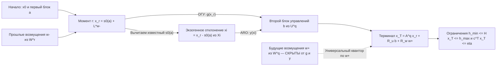
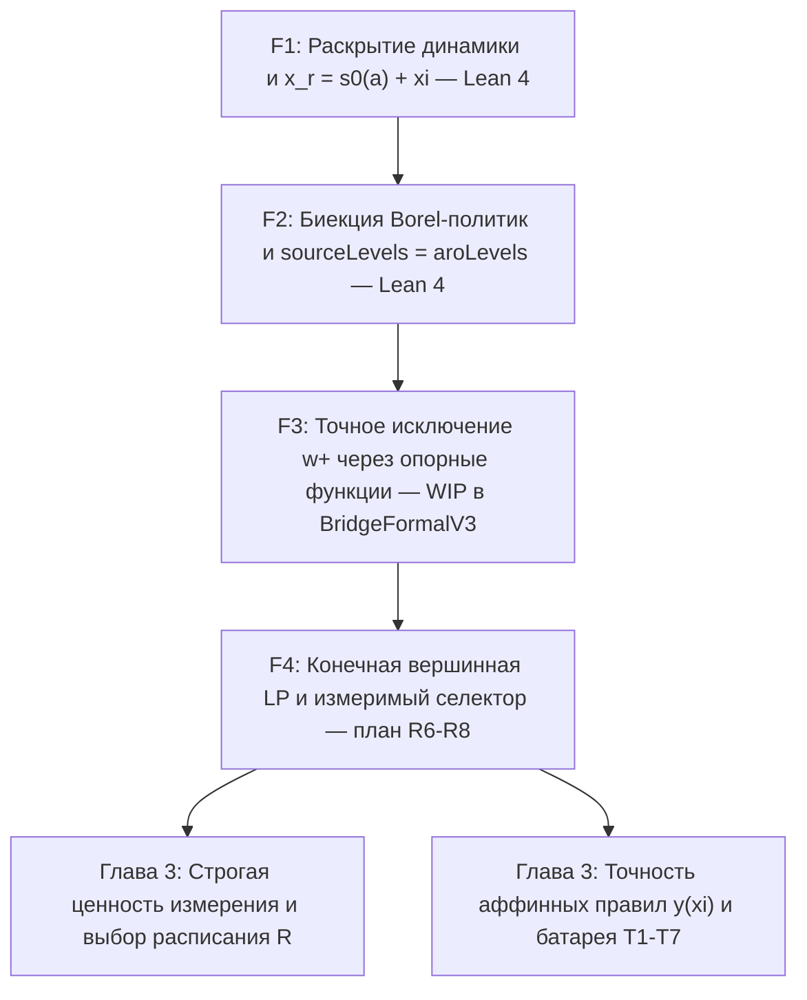

# Пакет 01: Мост ОГУ ↔ двухэтапная ARO (F1/F2) — интуиция и карта

> **Статус узла:** `formalized` (10 деклараций `BridgeFormalV2` скомпилированы в Lean 4 с чистыми аксиомами `{propext, Classical.choice, Quot.sound}`; независимый аудит — в [theorem-audit.json](../../../legacy/extracted/campaign/lean-audits/formal-v2/final-review/theorem-audit.json); финальную аттестацию `attested` ставит только владелец).
> **Опоры:** [A4_Дмитрук_2022.pdf](../../../corpus/our_papers/A4_Дмитрук_2022.pdf) (физ. с. 2–4), [A3_Костюкевич_Дмитрук_2021.pdf](../../../corpus/our_papers/A3_Костюкевич_Дмитрук_2021.pdf) (физ. с. 4), [02_BenTal_Goryashko_etal_2004.pdf](../../../corpus/02_BenTal_Goryashko_etal_2004.pdf) (физ. с. 3), [Model.lean](../../../verification/lean/BridgeFormalV2/Model.lean), [Goals.lean](../../../verification/lean/BridgeFormalV2/Goals.lean), исходный разбор [ogu-aro-01-foundation.md](../00-source-packet-01/ogu-aro-01-foundation.md).

---

## 1. Главная идея за 3 минуты

В задачах оптимального гарантированного управления (ОГУ) школы Дмитрук мы управляем линейной дискретной системой $x_{t+1} = A x_t + B u_t + E w_t$ на горизонте $T = r + q$ при неизвестных ограниченных возмущениях $w_t \in W = [-\rho, \rho]^p$. В фиксированный момент $r$ датчик один раз точно измеряет текущее состояние $x_r$. До измерения контроллер заранее задаёт первый блок управлений $a = (u_0, \ldots, u_{r-1})$, а после измерения выбирает весь оставшийся блок $b = g(x_r) = (u_r, \ldots, u_{T-1})$, не зная будущих возмущений $w^+ = (w_r, \ldots, w_{T-1})$.

На первый взгляд перевести эту задачу в стандартную двухэтапную адаптивную робастную оптимизацию (ARO) мешает **эндогенная неопределённость**: аргумент политики второй стадии $x_r$ зависит от решения первой стадии $a$. Множество достижимых состояний $S(a)$ сдвигается вместе с $a$, а классическая ARO требует **экзогенный** (не зависящий от $a$) параметр неопределённости $\xi \in \Xi$.

**Центральный трюк F1/F2:** линейность динамики мгновенно разделяет $x_r$ на два слагаемых:

$$
x_r \;=\; \underbrace{A^r x_0 + \sum_{t=0}^{r-1} A^{r-1-t} B a_t}_{s_0(a)\text{ — известный номинал}} \;+\; \underbrace{\sum_{t=0}^{r-1} A^{r-1-t} E w_t}_{\xi = L w^-\text{ — чистое отклонение}}.
$$

Поскольку контроллер сам выбрал первый блок $a$, он точно знает сдвиг $s_0(a)$. Измерив $x_r$, контроллер бесплатно вычисляет $\xi = x_r - s_0(a)$. При этом:
1. Никакой лишней информации не появляется: $\xi$ не раскрывает историю $w^-$, если разные префиксы дают одинаковое $L w^-$, и тем более не раскрывает будущее $w^+$.
2. Множество возможных отклонений $\Xi = L(W^r)$ **не зависит от первого решения $a$** — неопределённость становится чисто экзогенной.
3. Любую допустимую Borel-политику ОГУ $g : S(a) \to U^q$ и любое Borel-правило ARO $y : \Xi \to U^q$ связывает обратимый сдвиг аргумента:

$$
y(\xi) = g\bigl(s_0(a) + \xi\bigr), \qquad g(s) = y\bigl(s - s_0(a)\bigr).
$$

На каждом пути возмущений $(w^-, w^+)$ связанные политики порождают **тождественные управления, тождественные траектории $x_t$ и тождественные гарантированные уровни критерия $\eta$**. Значит, переход ОГУ $\leftrightarrow$ ARO сохраняет смысл задачи без потерь.

---

## 2. Визуальные схемы

### 2.1. Поток информации и разложение $x_r = s_0(a) + \xi$

### 2.2. Место Пакета 01 на карте диссертации

---

## 3. Границы: что доказано в Пакете 01, а что — нет

| Утверждение | Статус и опора | Что НЕ утверждается |
|---|---|---|
| Линейное раскрытие динамики и `x_r = s_0(a) + L w^-` для произвольных `A, B, E` | **Доказано в Lean 4** (`BridgeFormalV2.Proofs.expansion`, `prefix_split`, `source_chronology`, `suffix_expansion`) | Работает без обратимости `A` и без равенства `B = E`; область действия — стационарная дискретная динамика без промежуточных фазовых ограничений |
| Экзогенность образа `Ξ = L(W^r)` и инвариантность волокон наблюдения | **Доказано в Lean 4** (`BridgeFormalV2.Proofs.exogenous_image`, `observation_fibre`) | Одинаковое $x_r$ даёт один блок $b$; история $w^-$ и будущее $w^+$ не наблюдаются |
| Взаимный перевод Borel-политик и равенство `sourceLevels = aroLevels` | **Доказано в Lean 4** (`BridgeFormalV2.Proofs.forward_policy`, `reverse_policy`, `epigraph_equality`) | Не доказана эквивалентность Borel-класса произвольным неизмеримым стратегиям; не утверждается достижимость инфимума |
| Исключение $w^+$ через опорные функции (F3) и конечная вершинная LP (F4) | **Не входят в Пакет 01** (заготовка F3 лежит в [Support.lean](../../../verification/lean/BridgeFormalV3/Proofs/Support.lean)) | Пакет 01 ещё не даёт готовой конечной LP и не решает вопрос выбора оптимального момента $r$ |
| Точность аффинных решающих правил и мировая новизна | **Не заявляются в Пакете 01** | Пакет 01 задаёт точный фундамент переноса для проверки владельцем и научруком |
