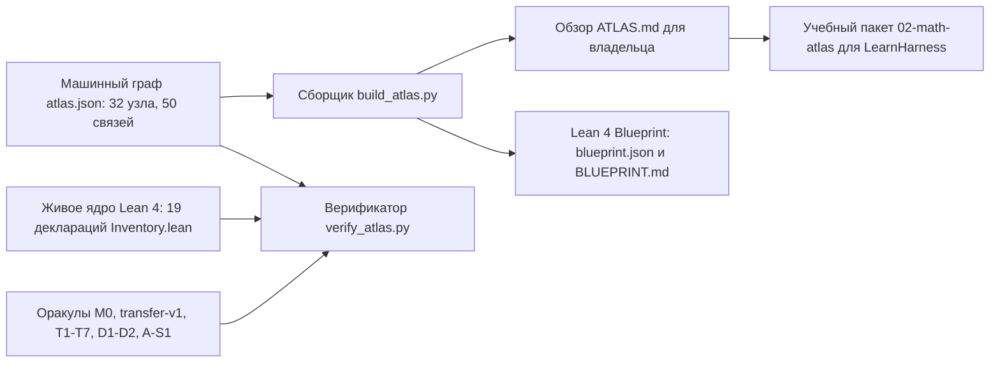
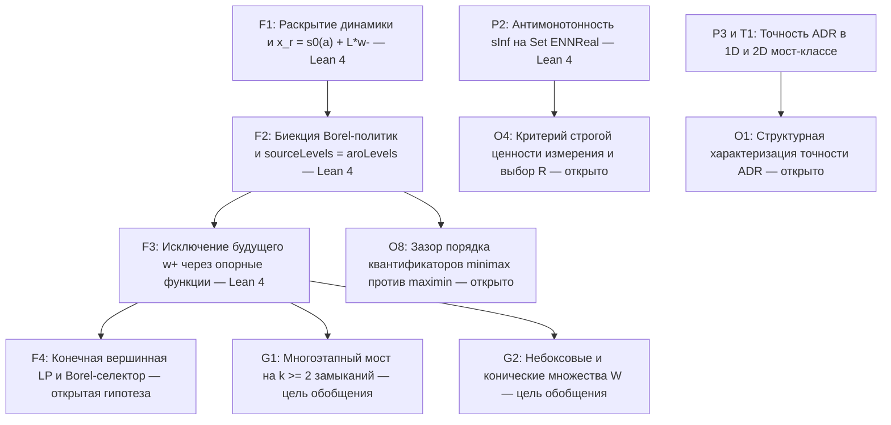

# Пакет 02: Фундаментальный математический атлас и Lean 4 Blueprint — интуиция и карта

> **Статус узла:** `draft` (машинный граф Атласа [atlas.json](../../atlas/atlas.json) и обзор [ATLAS.md](../../atlas/ATLAS.md) проверены гейтом `make verify-atlas`; все 19 формализованных деклараций подтверждены живым ядром Lean 4; аттестацию `attested` ставит только владелец).
> **Опоры:** [A4_Дмитрук_2022.pdf](../../../corpus/our_papers/A4_Дмитрук_2022.pdf), [A5_Дмитрук_диссертация_2022.pdf](../../../corpus/our_papers/A5_Дмитрук_диссертация_2022.pdf), [02_BenTal_Goryashko_etal_2004.pdf](../../../corpus/02_BenTal_Goryashko_etal_2004.pdf), [07_Xu_Burer_2017.pdf](../../../corpus/07_Xu_Burer_2017.pdf), [24_Georghiou_Tsoukalas_Wiesemann_2025.pdf](../../../corpus/24_Georghiou_Tsoukalas_Wiesemann_2025.pdf), [BLUEPRINT.md](../../../verification/lean/blueprint/BLUEPRINT.md), [verify_atlas.py](../../atlas/verify_atlas.py).

---

## 1. Зачем нужен Математический Атлас

Когда исследование охватывает сразу несколько связанных направлений — линейное гарантированное управление школы Дмитрук (ОГУ), двухэтапную адаптивную робастную оптимизацию (ARO), точность аффинных решающих правил (ADR) и выбор расписания замыканий $R$ — легко потерять границу между тем, что уже строго доказано в ядре Lean 4, что проверено только на конечных экземплярах, и что опровергнуто контрпримером.

Математический Атлас [atlas.json](../../atlas/atlas.json) задаёт единый направленный ациклический граф (DAG) из **32 узлов** и **50 связей** (`depends_on`, `refutes`, `generalizes`, `special_case_of`, `open_gap`, `constrains_adr`, `related_gap`). Каждый узел со статусом `lean_proved` привязан к реальной декларации ядра Lean 4 с фиксацией точной сигнатуры (`lean_signature`) и границ формализации (`formalized_scope`) и проходит живой аудит `#print axioms` с допустимыми аксиомами `{propext, Classical.choice, Quot.sound}`. Каждая открытая гипотеза обязана нести операционный критерий фальсификации: по какому оракулу и при каком нарушении гипотеза отвергается на этапе Stage 2 ещё до попытки доказательства.

---

## 2. Визуальные схемы

### 2.1. Архитектура Атласа и контура проверки

### 2.2. Исследовательская граница: от доказанного ядра к открытым задачам

---

## 3. Картина состояния: что доказано, что проверено, что открыто

| Слой Атласа | Число узлов | Машинная опора | Что остаётся за границей |
|---|---|---|---|
| **Доказано в Lean 4 (`lean_proved`)** | 11 узлов (19 деклараций) | [Inventory.lean](../../../verification/lean/AroProofs/Inventory.lean): `F1`, `F2`, `F3`, `P1–P3` | Нет конечной вершинной LP (`F4`), нет случая $k \ge 2$ замыканий (`G1`), нет общих конических множеств (`G2`) |
| **Проверено точными оракулами (`oracle_verified`)** | 8 узлов | [check.py](../../claims/bridge-transfer-v1/check.py), [finite_bellman.py](../../../verification/oracles/m0/pilot/checkers/finite_bellman.py), [battery_t1_t7.py](../../../verification/falsifiers/battery_t1_t7.py), [check.py](../../counterexamples/astra-probe-AS1/checks/check.py) | Сертификация на конечных семействах и эталонах не заменяет общей теоремы в Lean 4 |
| **Контрпримеры и границы (`falsified`)** | 7 узлов | `D1`, `D2`, `E`, `T2`, `T3`, `T4`, `T5` в [battery_t1_t7.py](../../../verification/falsifiers/battery_t1_t7.py) и `research/counterexamples/` | Показывают острые препятствия: слияние префиксов, потерю совместной допустимости, разрыв ADR $\Omega(s)$ и $\Omega(\sqrt{m})$ |
| **Открытые гипотезы и обобщения (`open`)** | 6 узлов | `F4`, `O4`, `O1`, `O8`, `G1`, `G2` в [atlas.json](../../atlas/atlas.json) | Каждая гипотеза снабжена точным условием опровержения до запуска Stage 3 |
