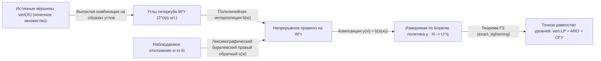

# F4: Конечная вершинная LP-редукция и борелевский селектор на зонотопе $\Xi = L(W^r)$

> Статус: `unattested_draft` (черновик для владельца и импорта в LearnHarness v0.7.0; статус `attested` ставит только человек).
> Основа: `BridgeF4CornerLP.lean` + `BridgeF4ExtremeLP.lean` (9/9 теорем Lean 4, `0 sorry`, только `[propext, Classical.choice, Quot.sound]`, `ALIGNMENT_OK` от независимого ревьюера `Pi/Sol`).

## Главная интуиция

После теорем **F1–F2** (эквивалентность ОГУ с одним замыканием и двухэтапной ARO) и **F3** (точное исключение будущего возмущения $w^+ \in W^q$ через опорные функции) остаётся задача с **континуальным** множеством префиксных отклонений:
$$\xi \in \Xi = L(W^r) = \{ D.\mathrm{deviation}(w^-) \mid w^- \in [-\rho, \rho]^{r \times p} \} \subset \mathbb{R}^n.$$

Вопрос **F4**: можно ли свести поиск борелевской политики $y : \Xi \to U^q$ по всему континууму $\Xi$ к **конечной линейной программе**, индексированной только истинными крайними точками $\operatorname{vert}(\Xi)$ — **даже если отображение $L$ не инъективно** (разные префиксы $w^-$ склеиваются в одно состояние $\xi$)?

**Ответ (доказано в Lean 4 без допущения об инъективности $L$):** **ДА!**

