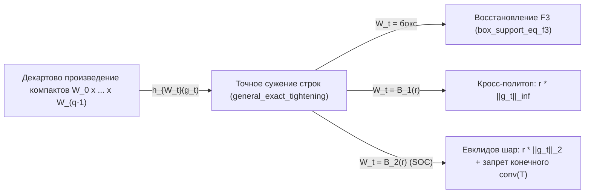

# G2: Обобщение сужения F3 на произвольные компактные и конические множества $W_t$

> Статус: `unattested_draft` (черновик для владельца и LearnHarness v0.7.0; статус `attested` ставит только человек).
> Основа: `BridgeG2ConicSupport.lean` (7/7 теорем Lean 4, `0 sorry`, только `[propext, Classical.choice, Quot.sound]`, `ALIGNMENT_OK` от `Pi/Sol`).

## Главная интуиция

В теореме **F3** будущее возмущение $w^+ \in [-\rho, \rho]^{q \times p}$ исключалось построчно с помощью формулы $\rho \sum_{t,i} |r^\top A^{q-1-t} E e_i|$. Что изменится, если на каждом будущем шаге $t \in \{0, \dots, q-1\}$ возмущение $w_t$ принадлежит произвольному непустому компактному множеству $W_t \subset \mathbb{R}^p$ — например, кросс-политопу $\ell_1$, евклидову шару $\ell_2$ (SOC) или компактному спектраэдру?

1. **Прямое опорное сужение универсально:** на декартовом произведении $\prod_t W_t$ точный наихудший отклик по каждой строке достигается и равен сумме опорных функций Минковского $\sum_t h_{W_t}(g_t)$.
2. **Частные замкнутые формы:** бокс $W_\infty(\rho)$ возвращает F3; кросс-политоп $B_1(r)$ даёт $r \|g_t\|_\infty$; шар $B_2(r)$ (SOC) даёт $r \|g_t\|_2$.
3. **Неполиэдральная граница:** двумерный шар $B_2(r)$ при $r > 0$ имеет бесконечно много крайних точек (рациональная стереографическая параметризация), поэтому конечная выпуклая оболочка (и наивная вершинная ЛП из F4) на него не переносится.

