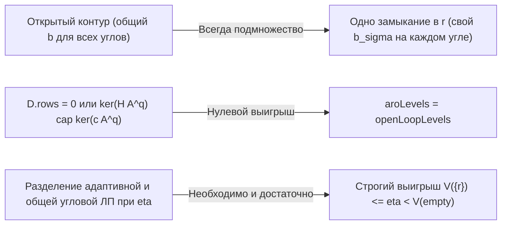

# O4 (часть 1): Ценность одного измерения, необходимые условия строгого выигрыша и критерий разделения

> Статус: `unattested_draft` (частичное покрытие O4 — фундамент для одного замыкания; статус `attested` ставит только человек).
> Основа: `BridgeO4ClosureValue.lean` (7/7 теорем Lean 4, `0 sorry`, `[propext, Classical.choice, Quot.sound]`, `ALIGNMENT_OK` от `Pi/Sol`, `findings: []`).

## Главная интуиция

Когда добавление одного замыкания в момент $r$ **действительно** улучшает гарантированный результат по сравнению с программным управлением ($V(\{r\}) < V(\emptyset)$)?

1. **Без терминальных ограничений ($\text{rows} = 0$) выигрыш ВСЕГДА нулевой!** При чисто боксовых управлениях и линейной стоимости $c^\top x_T$ оптимальный суффикс $b^*$ выбирается покоординатно независимо от префикса $\xi$. Значит, наличие терминальных ограничений ($D.\mathrm{rows} > 0$) **необходимо** для положительной ценности измерения.
2. **Если префикс невидим на выходе** ($\xi \in \ker(H A^q) \cap \ker(c A^q)$), замыкание также даёт нулевой выигрыш.
3. **Конечномерный критерий разделения:** на фиксированном уровне $\eta$ строгий выигрыш ($\eta \in D.\mathrm{aroLevels} \setminus \mathrm{openLoopLevels}\, D$) эквивалентен разрешимости адаптивной угловой ЛП (`VertexLPBound`) при неразрешимости общей угловой ЛП с единым суффиксом (`SharedCornerLPBound`).
4. **Немонотонность по $r$ (точный ЛП при $T=4$):** $V(\emptyset) = 6$, $V(\{1\}) = 4 > V(\{2\}) = 2 < V(\{3\}) = 4$ — оптимальный момент замыкания может лежать строго внутри горизонта!

