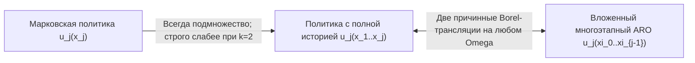

# G1 (часть 1): Многоэтапный мост ОГУ ↔ ARO для произвольного числа замыканий $k$ и строгое разделение Markov vs History при $k=2$

> Статус: `unattested_draft` (частичное покрытие G1; статус `attested` ставит только человек).
> Основа: `BridgeG1Multistage.lean` (6/6 теорем Lean 4, `0 sorry`, `[propext, Classical.choice, Quot.sound]`, `ALIGNMENT_OK` от `Pi/Sol`).

## Главная интуиция

При переходе от одного замыкания ($k=1$) к произвольному числу замыканий $k \ge 2$ возникают два фундаментальных вопроса:
1. **Переносится ли мост ОГУ ↔ ARO на произвольное $k$ и произвольное (в том числе коррелированное!) совместное множество возмущений $\Omega$?**
   - **Да — но только для политик с полной историей наблюдений!** На каждом этапе $j$ линейная динамика расщепляется на номинальное распространение от $x_j$ под действием выбранного управления и чисто экзогенное отклонение этапа $\xi_j$ (`multistage_stage_split`). Это даёт две причинные измеримые по Борелю трансляции между политиками по истории состояний $(x_1, \dots, x_j)$ и вложенными политиками ARO по истории экзогенных отклонений $(\xi_0, \dots, \xi_{j-1})$, гарантируя **точное равенство эпиграфов** (`multistage_history_epigraph_eq_aro`).
2. **Достаточно ли марковской обратной связи $u_j(x_j)$ (только по текущему состоянию), как при $k=1$?**
   - **НЕТ!** При $k = 2$ и коррелированном множестве возмущений ($w_0 = w_2 \in \{-1/2, +1/2\}$, $w_1 \in [-1, 1]$) политика с памятью помнит $x_1 = 2 w_0$ и достигает терминального значения $0$, тогда как **любая** марковская политика (даже с произвольным нелинейным борелевским дуальным сигналингом через $x_2$ на этапе 1!) получает гарантированно не меньше $2$ — противник выбирает встречный шум $w_1^{\pm} = \pm (a_- - a_+)/4 \in [-1, 1]$, который стирает сигнал и сталкивает траектории в одной точке $x_2(\omega^+) = x_2(\omega^-)$!

