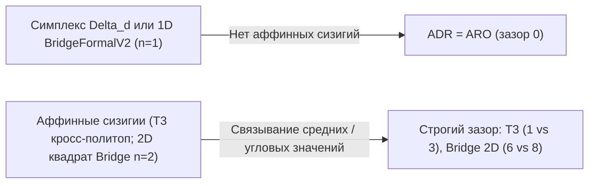

# O1 (часть 1): Точность ADR на симплексе, барицентрические сизигии (T3) и порог размерности $n=1$ против $n=2$ в замороженном `BridgeFormalV2.Data`

> Статус: `unattested_draft` (частичное покрытие O1; статус `attested` ставит только человек).
> Основа: `BridgeO1ADRExactness.lean` (7/7 теорем Lean 4, `0 sorry`, `[propext, Classical.choice, Quot.sound]`, `ALIGNMENT_OK` от `Pi/Sol`).

## Главная интуиция

Почему аффинное решающее правило (ADR) $y(\xi) = y_0 + Y\xi$ иногда совпадает с полностью адаптивным оптимумом ($V_{\mathrm{ADR}} = V_{\mathrm{ARO}}$), а иногда терпит крах?

1. **На стандартном $d$-симплексе $\Delta_d$ ADR ВСЕГДА точно (`adr_exact_on_simplex`):**
   Вершины $0, e_1, \dots, e_d$ аффинно независимы — любой набор вершинных решений $y(0), y(e_1), \dots, y(e_d)$ однозначно продолжается до аффинного правила $y_0 = y(0),\ Y_{r,j} = y(e_j)_r - y(0)_r$, сохраняя допустимость и оценку на всём $\Delta_d$.
2. **Барицентрические сизигии разрушают точность ADR (`barycentric_syzygy_adr_coupling`, `chen_zhang_t3_adr_gap`):**
   Как только две конечные аффинные комбинации (в частности, два дискретных распределения вероятностей) на $\Xi$ имеют один и тот же барицентр $\sum \alpha_a \xi_a = \sum \beta_b \zeta_b$, **любое** аффинное правило обязано иметь одинаковые средние значения $\sum \alpha_a y(\xi_a) = \sum \beta_b y(\zeta_b)$. На 3D-кросс-политопе Чэня–Чжана (T3) три сизигии $\frac{1}{2}(+e_i) + \frac{1}{2}(-e_i) = 0$ принуждают $y_0(i) \ge 1$ для всех $i=1,2,3$, давая $V_{\mathrm{ADR}} \ge 3 > 1 = V_{\mathrm{ARO}}$.
3. **Точный порог размерности внутри нашего замороженного моста ОГУ ↔ ARO (`BridgeFormalV2.Data`):**
   - **При $D.n = 1$ (одномерное состояние) ADR ВСЕГДА точно (`bridge_adr_exact_1d`)** для любых горизонтов $r, q$, размерностей управления/шума $m, p$, матриц $A, B, E, H$ и векторов $c, g_{\min}, g_{\max}$! Причина: множество отклонений $\Xi \subset \mathbb{R}^1$ — отрезок (1-симплекс), и линейная интерполяция между $\xi_{\min}$ и $\xi_{\max}$ сохраняет все суженные ограничения F3.
   - **Уже при $D.n = 2$ точность ADR нарушается строго (`exists_bridge_2d_strict_adr_gap`)!** На простейшем 2D-интеграторе с одним общим скалярным управлением $B = (1,1)^\top$, $A=E=H=I_2$, $g \in [0,4]^2$, $c = (1,1)^\top$, $u \in [-1,1]$, $\rho = 1$ кусочно-аффинное правило $u_1 = 1,\ u_2^*(v_0, v_1) = \max(-v_0, -v_1)$ даёт **$V_{\mathrm{ARO}} = 6$**, тогда как любое аффинное правило привязано угловыми ограничениями квадрата к статическому $u_1 = 1,\ u_2 \equiv 1$ со значением **$V_{\mathrm{ADR}} \ge 8$**!

