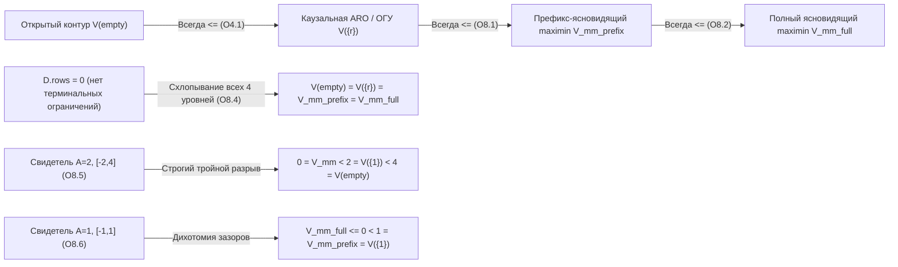

# O8 (часть 1): Зазор порядка квантификаторов minimax против maximin — иерархия, обнуление и дихотомия

> Статус: `unattested_draft` (частичное покрытие O8 — иерархия квантификаторов, необходимое условие `D.rows > 0` и два машинных свидетеля; статус `attested` ставит только человек).
> Основа: `BridgeO8QuantifierGap.lean` (7 теорем Lean 4, `0 sorry`, аксиомы строго `[propext, Classical.choice, Quot.sound]`), точный оракул `check_o8_gap.py` и фальсификатор `run02_falsify.py`.

## Главная интуиция

В задаче гарантированного управления (ОГУ) и двухэтапной адаптивной робастной оптимизации (ARO) порядок квантификаторов **принципиален**:

1. **Четыре уровня иерархии эпиграфов (для любой системы `D : Data`):**
   $$\mathrm{openLoopLevels}(D) \subseteq D.\mathrm{aroLevels} = D.\mathrm{sourceLevels} \subseteq \mathrm{prefixMaximinLevels}(D) \subseteq \mathrm{fullMaximinLevels}(D),$$
   что соответствует неравенствам значений $V_{\mathrm{mm}}^{\mathrm{full}} \le V_{\mathrm{mm}}^{\mathrm{prefix}} \le V(\{r\}) \le V(\emptyset)$.
2. **Обнуление всех зазоров без терминальных ограничений (`D.rows = 0`):** если терминальное состояние не ограничено, а управления боксовые и стоимость линейна, то **вся четырёхуровневая иерархия схлопывается в одно множество**:
   $$\mathrm{openLoopLevels}(D) = D.\mathrm{aroLevels} = \mathrm{prefixMaximinLevels}(D) = \mathrm{fullMaximinLevels}(D).$$
   Следовательно, непустые терминальные ограничения (`D.rows > 0`) **строго необходимы** не только для положительной ценности измерения (O4), но и для любого зазора порядка квантификаторов (O8).
3. **Разделение двух источников зазора:**
   - *Зазор префиксного обязательства* $V(\{r\}) - V_{\mathrm{mm}}^{\mathrm{prefix}}$ возникает из-за того, что до момента $r$ управление $a$ выбирается до реализации префиксного возмущения $w^-$. На неустойчивом свидетеле `ce-o8-sion-gap` ($A = 2$, $g \in [-2, 4]$) доказан строгий тройной разрыв $V_{\mathrm{mm}}^{\mathrm{full}} = V_{\mathrm{mm}}^{\mathrm{prefix}} = 0 < 2 = V(\{1\}) < 4 = V(\emptyset)$.
   - *Неустранимый зазор будущего шума* $V_{\mathrm{mm}}^{\mathrm{prefix}} - V_{\mathrm{mm}}^{\mathrm{full}}$ сохраняется даже тогда, когда префиксный зазор равен нулю. На симметричном 1D-интеграторе ($A = 1$, $g \in [-1, 1]$) доказано $V_{\mathrm{mm}}^{\mathrm{full}} \le 0 < 1 = V_{\mathrm{mm}}^{\mathrm{prefix}} = V(\{1\})$.

