# O4 / O7 (часть 2): Решётка расписаний замыканий, супермодулярная синергия и двустороннее доминирование

> Статус: `unattested_draft` (частичное покрытие `O4 + O7` — решётка монотонности на горизонте $T = 3$, схлопывание при `D.rows = 0`, строгое опровержение субмодулярности $G(R)$ и двустороннее доминирование одиночных замыканий; статус `attested` ставит только человек).
> Основа: `BridgeO4Scheduling.lean` (8 теорем Lean 4, `0 sorry`, аксиомы строго `[propext, Classical.choice, Quot.sound]`), точный оракул `check_o4_synergy.py` и многоэтапный фундамент `BridgeG1Multistage.lean`.

## Главная интуиция

При переходе от одного замыкания ($k = 1$) к выбору **расписания замыканий** $R \subseteq \{1, \dots, T-1\}$ на горизонте $T = 3$ функция ценности информации $G(R) = V(\emptyset) - V(R)$ ведёт себя принципиально богаче, чем классическая субмодулярная максимизация покрытия:

1. **Решётка монотонности расписаний (для любой системы `D : Data`):**
   $$\mathrm{schedEmptyLevels}(D) \subseteq \mathrm{schedR1Levels}(D),\; \mathrm{schedR2Levels}(D) \subseteq \mathrm{schedR12Levels}(D),$$
   то есть добавление нового момента замыкания никогда не ухудшает гарантированный результат: $V(\{1,2\}) \le V(\{1\}), V(\{2\}) \le V(\emptyset)$.
2. **Полное схлопывание без терминальных ограничений (`D.rows = 0`):** если терминальное состояние не ограничено, а управления боксовые и стоимость линейна, то **все четыре расписания схлопываются в открытый контур**:
   $$V(\emptyset) = V(\{1\}) = V(\{2\}) = V(\{1,2\}).$$
   Следовательно, наличие жёстких терминальных ограничений (`D.rows > 0`) необходимо не только для одиночного замыкания (O4.2), но и для любого многоэтапного выигрыша.
3. **Строгая супермодулярная синергия (опровержение субмодулярности $G(R)$):**
   На 4-мерной линейной стационарной системе со сдвиговым регистром (`synergyWitnessData`, $A: e_3 \mapsto e_0 \mapsto e_1 \mapsto e_2 \mapsto 0$, $B = e_0$, $E = e_3$, $U = [-1, 1]$, $\rho = 1$) терминальное состояние имеет вид $x_3 = (u_2 + w_1, u_1 + w_0, u_0, w_2)^T$, а ограничения кодируют $u_0 \ge |u_1 + w_0|$ и $u_0 \ge |u_2 + w_1|$ при минимизации $u_0$:
   - каждое одиночное замыкание обнуляет только одно из двух слагаемых в $\max(|u_1 + w_0|, |u_2 + w_1|)$, поэтому $V(\emptyset) = V(\{1\}) = V(\{2\}) = 1$ ($G(\{1\}) = G(\{2\}) = 0$);
   - совместное расписание $R = \{1, 2\}$ обнуляет оба слагаемых сразу, давая $V(\{1, 2\}) = 0$ ($G(\{1, 2\}) = 1$).
   Дефект субмодулярности равен $+1 > 0$, а жадный алгоритм выбора замыканий имеет **нулевой коэффициент аппроксимации**.
4. **Дихотомия субмодулярности и двустороннее доминирование одиночных замыканий (`O7`):**
   - На 1D-интеграторе (`earlyDomWitnessData`, $A = 1$, $U = [-1/2, 1/2]$, $g \in [-2, 10]$): $V(\emptyset) = 4$, $V(\{1\}) = 2 < 3 = V(\{2\})$, $V(\{1,2\}) = 2$ — **строгая субмодулярность** (дефект $-1$) и **раннее доминирование** ($r = 1$ строго лучше $r = 2$).
   - На 1D-сжимающей системе (`lateDomWitnessData`, $A = 1/2$, $U = [-1, 1]$, $g \in [-2, 10]$): $V(\emptyset) = 3/2$, $V(\{1\}) = 1 > 0 = V(\{2\}) = V(\{1,2\})$ — **позднее доминирование** ($r = 2$ строго лучше $r = 1$).

```mermaid
flowchart TD
  E["Открытый контур V(empty)"] -->|"O4.7a"| R1["Раннее замыкание V({1})"]
  E -->|"O4.7b"| R2["Позднее замыкание V({2})"]
  R1 -->|"O4.7c"| R12["Два замыкания V({1,2})"]
  R2 -->|"O4.7d"| R12
  R0["D.rows = 0 (O4.8)"] -->|"Схлопывание решётки"| EQ["V(empty) = V({1}) = V({2}) = V({1,2})"]
  SYN["4D сдвиговый регистр (O4.9)"] -->|"Супермодулярная синергия (+1)"| G1["G({1}) = G({2}) = 0, G({1,2}) = 1"]
  ED["1D интегратор A=1 (O4.10)"] -->|"Субмодулярность (-1) и раннее доминирование"| G2["V({1}) = 2 < 3 = V({2})"]
  LD["1D сжатие A=1/2 (O4.11)"] -->|"Позднее доминирование"| G3["V({2}) = 0 < 1 = V({1})"]
```

