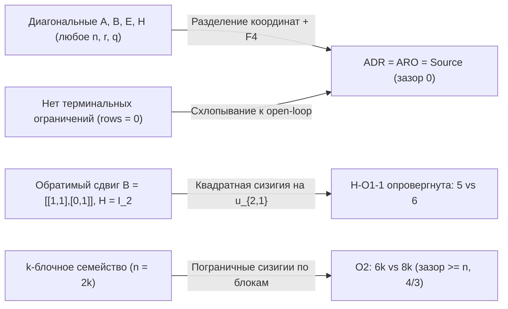

# O1 / O2 / O5 (часть 2): Опровержение `H-O1-1`, точная граница диагональности и линейный рост зазора ADR

> Статус: `unattested_draft` (статус `attested` ставит только человек).
> Основа: `BridgeO1FullRankRecourse.lean` (8/8 теорем Lean 4, `0 sorry`, `[propext, Classical.choice, Quot.sound]`, замороженное ядро `BridgeFormalV2.Model` / `Goals` не изменено).

## Главная интуиция

В цикле 01–02 (модуль `BridgeO1ADRExactness.lean`) мы установили порог размерности $n = 1$ против $n = 2$ для аффинных решающих правил (ADR) внутри моста ОГУ $\leftrightarrow$ ARO. Возникла естественная гипотеза **`H-O1-1`**: достаточно ли **полного ранга (обратимости) матрицы рекурса $B$** при покоординатном терминальном боксе $H = I_2$, чтобы вернуть точность $V_{\mathrm{ADR}} = V_{\mathrm{ARO}}$?

В цикле 03 принцип **Falsify-First** дал точный и неожиданный ответ: **нет — гипотеза `H-O1-1` опровергнута!**

1. **Опровержение `H-O1-1` (унимодулярный сдвиг $B \in \mathrm{SL}_2(\mathbb{Z})$, `exists_bridge_2d_fullrank_invertible_strict_adr_gap`):**
   Даже при $A = E = H = I_2$ и обратимой унимодулярной матрице рекурса $B = \begin{pmatrix} 1 & 1 \\ 0 & 1 \end{pmatrix}$ ($\det B = 1$, биекция `shearRecourse_bijective`) на боксе управления $U = [-1/2, 1/2]^2$ внедиагональная единица связывает насыщающееся управление $u_{2,1}$ сразу с обеими координатами состояния. Квадратная барицентрическая сизигия принуждает $u_{2,1}(1, 1) \ge 1/2$ для любого аффинного правила, давая $V_{\mathrm{ADR}} \ge 6 > 5 = V_{\mathrm{ARO}}$.
2. **Острая положительная граница — произвольно-мерная диагональная точность (`bridge_adr_exact_diagonal`):**
   Если матрицы $A, B, E, H$ **диагональны** в стандартном базисе ($n = m = p = \mathrm{rows}$), то для **любой** размерности $n \ge 1$, **любых** горизонтов $r, q \ge 1$ и **произвольного** линейного критерия $c \in \mathbb{R}^n$ аффинные правила **всегда точны**: $V_{\mathrm{ADR}} = V_{\mathrm{ARO}} = V_{\mathrm{source}}$. Таким образом, ровно **одна внедиагональная единица** в $B$ отделяет универсальную точность от строгого зазора!
3. **Необходимые условия строгого зазора (`O5`, `bridge_adr_exact_of_unconstrained_terminal`):**
   При `D.rows = 0` (отсутствие терминальных ограничений) вся иерархия схлопывается до разомкнутого управления и ADR всегда точно. Следовательно, строгий зазор $V_{\mathrm{ADR}} > V_{\mathrm{ARO}}$ требует одновременно $n \ge 2$, $\mathrm{rows} \ge 1$ и внедиагональной связи в $(A, B, E, H)$.
4. **Линейный рост $\Omega(n)$ зазора ADR (`O2`, `exists_bridge_linear_adr_gap_scaling`):**
   Для любого $k \ge 1$ существует система размерности $n = 2k$ внутри замороженного `BridgeFormalV2.Data`, на которой $V_{\mathrm{ARO}} = V_{\mathrm{source}} \le 6k$, а любое аффинное правило (даже с произвольной межблочной обратной связью $K \in \mathbb{R}^{k \times 2k}$) удовлетворяет $V_{\mathrm{ADR}} \ge 8k$: аддитивный зазор растёт линейно ($\ge 2k = n$) с мультипликативным отношением $\ge 4/3$.

