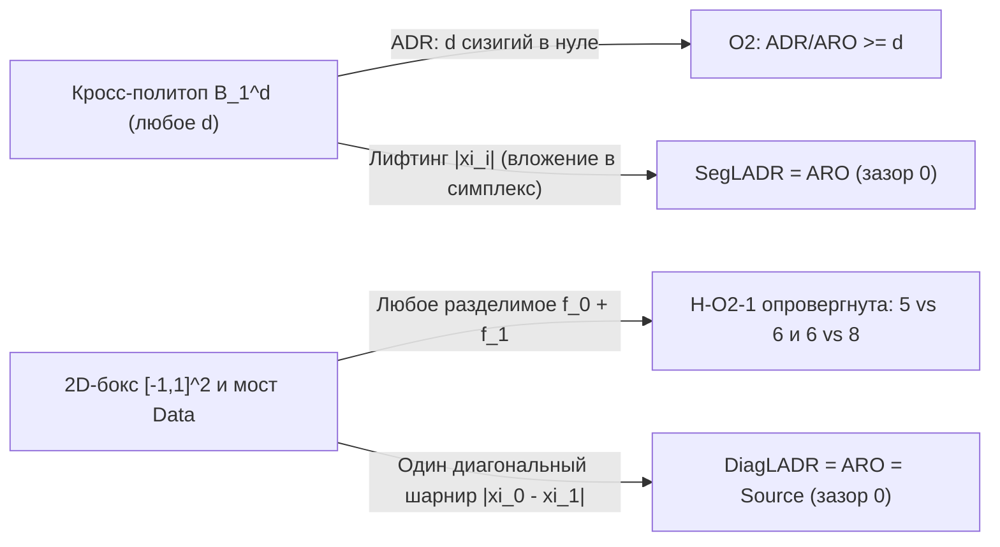

# O2 / O5: Лифтинговые и кусочно-аффинные правила, рост $\Omega(d)$, опровержение `H-O2-1` и диагональный шарнир

> Статус: `unattested_draft` (статус `attested` ставит только человек).
> Основа: `BridgeO2LiftedADR.lean` (8/8 теорем Lean 4, `0 sorry`, `[propext, Classical.choice, Quot.sound]`, замороженное ядро `BridgeFormalV2.Model` / `Goals` не изменено).

## Главная интуиция

После циклов 01–03 мы знали, что стандартные аффинные решающие правила (ADR) ломаются на 2D-боксе $[-1, 1]^2$ даже при обратимом унимодулярном рекурсе $B \in \mathrm{SL}_2(\mathbb{Z})$ (`bridgeFullRankShearData`, зазор $5 < 6$) и на $\ell_1$-кросс-политопе Чэня–Чжана (`chen_zhang_t3_adr_gap`). Возникает главный вопрос задач **O2** и **O5**: **насколько велик мультипликативный зазор ADR как функция геометрии $\Xi$, и какое минимальное нелинейное расширение (лифтинг $\phi(\xi)$) закрывает этот зазор?**

В цикле 04 принцип **Falsify-First** дал сразу четыре точных результата, объединяющих геометрию $\Xi$ и структуру лифтинга:

1. **Точный линейный мультипликативный рост $\Omega(d)$ на $\ell_1$-кросс-политопе $B_1^d$ (`l1_cross_polytope_adr_ratio_linear`):**
   Для **любой** размерности $d \ge 1$ на $B_1^d = \{\xi \in \mathbb{R}^d : \sum_i |\xi_i| \le 1\}$ задача Чэня–Чжана имеет адаптивный оптимум $V_{\mathrm{ARO}}(d) = 1$, тогда как любое аффинное правило даёт $V_{\mathrm{ADR}}(d) \ge d$ — точное мультипликативное отношение $\ge d$.
2. **Полная точность покоординатного $|\cdot|$-лифтинга на $B_1^d$ (`segregated_ladr_exact_on_l1_cross_polytope`):**
   Добавление покоординатных модулей $\phi_{\mathrm{abs}}(\xi) = (|\xi_1|, \dots, |\xi_d|)$ (эквивалентно разделению $\xi^+, \xi^-$) вкладывает $B_1^d$ в стандартный симплекс $\Delta_{2d}$ и делает лифтинговое ADR **100% точным для любой задачи ARO с фиксированным рекурсом в любой размерности $d \ge 1$**, обнуляя зазор $\Omega(d)$.
3. **Опровержение `H-O2-1` — покоординатно-разделимые лифтинги бессильны на боксе $[-1, 1]^2$ (`separable_rule_square_syzygy`, `exists_bridge_2d_separable_strict_gap`):**
   Естественная гипотеза `H-O2-1` предполагала, что покоординатный $|\cdot|$-лифтинг (или кусочно-аффинный лифтинг с разбиениями по осям) закроет зазор и на 2D-боксе $[-1, 1]^2$. **Опровергнуто:** вообще **любое** покоординатно-разделимое правило $y(\xi_0, \xi_1) = y_0 + f_0(\xi_0) + f_1(\xi_1)$ с произвольными (даже разрывными нелинейными) функциями $f_0, f_1$ по-прежнему удовлетворяет точной квадратной сизигии $y(-1,1) + y(1,-1) = y(-1,-1) + y(1,1)$ и даёт **нулевое улучшение** на обоих 2D-мостах (`5 < 6` на унимодулярном сдвиге и `6 < 8` на ранге 1)!
4. **Острое положительное разрешение — один скалярный диагональный шарнир $|\xi_0 - \xi_1|$ закрывает зазор на 2D-боксе (`diagonal_lifted_adr_exact_on_box2d`, `bridge_diagonal_lifted_adr_exact_2d_box`):**
   Добавление ровно **одного** межкоординатного признака $\phi_{\mathrm{diag}}(\xi) = |\xi_0 - \xi_1|$ ломает квадратную сизигию ($2 + 2 \ne 0 + 0$), точно воспроизводит барицентрическую интерполяцию на триангуляции Куна $\{ \xi_0 \le \xi_1 \} \cup \{ \xi_1 \le \xi_0 \}$ с коэффициентом $Z = \tfrac{1}{4}(y_{-+} + y_{+-} - y_{--} - y_{++})$ (буквально $1/4$ дефекта квадратной сизигии!) и даёт **100% точность** для **любой** задачи ARO на $[-1, 1]^2$ и **любой** 2D-системы `BridgeFormalV2.Data` с прямоугольным множеством отклонений $[-r_0, r_0] \times [-r_1, r_1]$.

