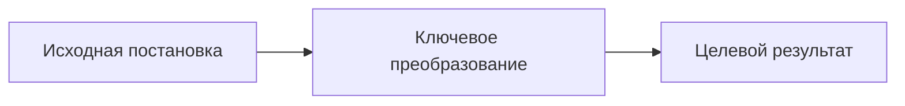

# <NN>: <Короткое название темы> — интуиция и карта

> **Статус узла:** `<conjectured | survived-falsifier | formalized | verified>` (аттестацию `attested` ставит только владелец).
> **Опоры:** указать PDF из `corpus/` (физические страницы) и проверенные артефакты из `verification/` / `research/`.

## 1. Главная идея за 3 минуты

Объяснить простым русским языком: какую задачу решаем, в чём центральный трюк и почему без этого результата дальнейшие шаги не работают.

## 2. Визуальная схема (Mermaid)

## 3. Место на карте диссертации

Кратко показать, на какие узлы опирается тема и какие открытые шаги она разблокирует.

## 4. Границы: что доказано, а что — нет

| Утверждение | Статус и опора | Что НЕ утверждается |
|---|---|---|
| `<Факт 1>` | `<Lean / оракул / PDF>` | `<Явное ограничение>` |
