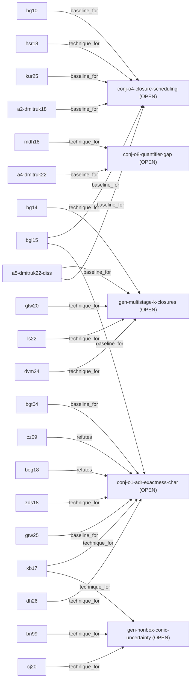

# Литературный радар и граф знаний — aro-discovery v2

> Автоматически сгенерировано из [catalog.json](catalog.json) скриптом [radar.py](radar.py). Проверка целостности и связей с Атласом: `make verify-literature` ([verify_literature.py](verify_literature.py)).
> Связанный Математический Атлас: [ATLAS.md](../atlas/ATLAS.md) | Проверка новизны: `python3 -m research.literature.novelty --conjecture <node_id>`.

## 1. Сводка каталога

| Метрика | Значение |
|---|---|
| Всего индексированных работ | **24** |
| Привязано к физическим PDF в `corpus/` | **24** |
| С верифицированным DOI / arXiv ID | **13 DOI / 5 arXiv** |
| Типизированных связей с Атласом | **44** (`baseline_for`=11, `generalizes`=1, `refutes`=2, `supports`=13, `technique_for`=17) |
| Покрыто узлов `atlas.json` | **18 из 37** |

## 2. Граф связей литературы с открытым фронтом Атласа (Mermaid)

## 3. Каталог ключевых работ

| ID | Авторы и год | Название | Идентификаторы | Связи с Атласом |
|---|---|---|---|---|
| `bn99` | Aharon Ben-Tal, Arkadi Nemirovski (1999) | Robust solutions of uncertain linear programs | `corpus/01_BenTal_Nemirovski_1999.pdf` | `technique_for` → `gen-nonbox-conic-uncertainty` (p. 2,3), `baseline_for` → `ax-fixed-recourse-box` (p. 1,2) |
| `bgt04` | Aharon Ben-Tal, Alexander Goryashko et al. (2004) | Adjustable robust solutions of uncertain linear programs | DOI `10.1007/s10107-003-0454-y`; `corpus/02_BenTal_Goryashko_etal_2004.pdf` | `supports` → `ax-fixed-recourse-box` (p. 3,4), `supports` → `thm-t6-box-static-exact` (p. 4,5), `baseline_for` → `conj-o1-adr-exactness-char` (p. 8,10) |
| `cz09` | Xin Chen, Yuhan Zhang (2009) | Uncertain Linear Programs: Extended Affinely Adjustable Robust Counterparts | DOI `10.1287/opre.1080.0605`; `corpus/03_Chen_Zhang_2009.pdf` | `supports` → `ce-t3-chen-zhang` (p. 6), `refutes` → `conj-o1-adr-exactness-char` (p. 6) |
| `bg10` | Dimitris Bertsimas, Vineet Goyal (2010) | On the Power of Robust Solutions in Two-Stage Stochastic and Adaptive Optimization Problems | DOI `10.1287/moor.1090.0440`; `corpus/extra/BG10-author.pdf` | `technique_for` → `ce-t5-beg18-separating` (p. 11,12), `baseline_for` → `conj-o4-closure-scheduling` (p. 1,2) |
| `zz13` | Bo Zeng, Long Zhao (2013) | Solving two-stage robust optimization problems using a column-and-constraint generation method | DOI `10.1016/j.orl.2013.05.003`; `corpus/12_Zeng_Zhao_2013.pdf` | `technique_for` → `conj-f4-vertex-lp-selector` (p. 2,3) |
| `bg14` | Dimitris Bertsimas, Angelos Georghiou (2014) | Design of Near Optimal Decision Rules in Multistage Adaptive Mixed-Integer Optimization | `corpus/20_Bertsimas_Georghiou_2014.pdf` | `technique_for` → `gen-multistage-k-closures` (p. 2,28) |
| `bgl15` | Dimitris Bertsimas, Vineet Goyal et al. (2015) | A tight characterization of the performance of static solutions in two-stage adjustable robust linear optimization | `corpus/04_Bertsimas_Goyal_Lu_2015.pdf` | `baseline_for` → `conj-o4-closure-scheduling` (p. 1,9), `baseline_for` → `conj-o1-adr-exactness-char` (p. 32) |
| `ap16` | Josette Ayoub, Michael Poss (2016) | Decomposition for adjustable robust linear optimization subject to uncertainty polytope | `corpus/06_Ayoub_Poss_2016.pdf` | `technique_for` → `conj-f4-vertex-lp-selector` (p. 4,6) |
| `bdr16` | Dimitris Bertsimas, Frans J. C. T. de Ruiter (2016) | Duality in Two-Stage Adaptive Linear Optimization: Faster Computation and Stronger Bounds | DOI `10.1287/ijoc.2016.0689`; `corpus/05_Bertsimas_deRuiter_2016.pdf` | `supports` → `thm-t6-box-static-exact` (p. 12), `technique_for` → `conj-f4-vertex-lp-selector` (p. 6,7) |
| `xb17` | Guanglin Xu, Samuel Burer (2017) | A copositive approach for two-stage adjustable robust optimization with uncertain right-hand sides | DOI `10.1007/s10589-017-9974-x`; `corpus/07_Xu_Burer_2017.pdf` | `supports` → `ce-t2-soc-temporal` (p. 15,16,17), `technique_for` → `conj-o1-adr-exactness-char` (p. 10,12), `technique_for` → `gen-nonbox-conic-uncertainty` (p. 15,17) |
| `a2-dmitruk18` | Natalia M. Dmitruk (2018) | Optimal guaranteed control with one closure in linear nonstationary systems | DOI `10.7868/S0044466918050010`; `corpus/our_papers/A2_Дмитрук_2018.pdf` | `baseline_for` → `conj-o4-closure-scheduling` (p. 18), `supports` → `def-ogu-system` (p. 1,3) |
| `beg18` | Aharon Ben-Tal, Omar El Housni et al. (2018) | A Tractable Approach for Designing Piecewise Affine Policies in Two-stage Adjustable Robust Optimization | arXiv `1801.06751v1`; `corpus/10_BenTal_ElHousni_Goyal_2018.pdf` | `supports` → `ce-t5-beg18-separating` (p. 14,15), `refutes` → `conj-o1-adr-exactness-char` (p. 14,15) |
| `hsr18` | Ali Haddad-Sisakht, Sarah M. Ryan (2018) | Conditions under which adjustability lowers the cost of a robust linear program | DOI `10.1007/s10479-018-2954-4`; `corpus/08_HaddadSisakht_Ryan_2018.pdf` | `technique_for` → `conj-o4-closure-scheduling` (p. 6,18) |
| `mdh18` | Ahmadreza Marandi, Dick den Hertog (2018) | When are static and adjustable robust optimization problems with constraint-wise uncertainty equivalent? | DOI `10.1007/s10107-017-1166-z`; `corpus/09_Marandi_denHertog_2018.pdf` | `generalizes` → `thm-t6-box-static-exact` (p. 7), `technique_for` → `conj-o8-quantifier-gap` (p. 7,8) |
| `zds18` | Jianzhe Zhen, Dick den Hertog et al. (2018) | Adjustable Robust Optimization via Fourier-Motzkin Elimination | DOI `10.1287/opre.2017.1714`; `corpus/21_Zhen_denHertog_Sim_2018.pdf` | `supports` → `thm-t7-simplex-exact` (p. 12), `technique_for` → `conj-o1-adr-exactness-char` (p. 11,12) |
| `cj20` | Thai Doan Chuong, Vaithilingam Jeyakumar (2020) | Generalized Farkas Lemma with Adjustable Variables and Two-Stage Robust Linear Programs | DOI `10.1007/s10957-020-01753-3`; `corpus/15_Chuong_Jeyakumar_2020.pdf` | `technique_for` → `gen-nonbox-conic-uncertainty` (p. 3,5) |
| `gtw20` | Angelos Georghiou, Angelos Tsoukalas et al. (2020) | A Primal-Dual Lifting Scheme for Two-Stage Robust Optimization | DOI `10.1287/opre.2019.1873`; `corpus/23_Georghiou_Tsoukalas_Wiesemann_2020.pdf` | `technique_for` → `conj-f4-vertex-lp-selector` (p. 2,4), `technique_for` → `gen-multistage-k-closures` (p. 2,5) |
| `a4-dmitruk22` | Natalia M. Dmitruk (2022) | Multiply-closed strategy in a linear terminal guaranteed-control problem | DOI `10.21538/0134-4889-2022-28-3-66-82`; `corpus/our_papers/A4_Дмитрук_2022.pdf` | `supports` → `thm-transfer-a4-v1` (p. 4,12), `supports` → `thm-f2-epigraph-equality` (p. 2,3,4), `baseline_for` → `conj-o8-quantifier-gap` (p. 4,10) |
| `a5-dmitruk22-diss` | Natalia M. Dmitruk (2022) | Optimal guaranteed control of linear systems with disturbances (Chapter 2, Dissertation) | `corpus/our_papers/A5_Дмитрук_диссертация_2022.pdf` | `supports` → `lem-p2-info-monotone` (p. 3), `baseline_for` → `gen-multistage-k-closures` (p. 17,19), `baseline_for` → `conj-o4-closure-scheduling` (p. 39) |
| `ls22` | Haihao Lu, Bradley Sturt (2022) | On the Sparsity of Optimal Linear Decision Rules for a Class of Robust Optimization Problems with Box Uncertainty Sets | arXiv `2203.10661v4`; `corpus/11_Lu_Sturt_2022.pdf` | `technique_for` → `gen-multistage-k-closures` (p. 1,8) |
| `dvm24` | Aditya Dave, Nishanth Venkatesh et al. (2024) | Approximate Information States for Worst-Case Control and Learning in Uncertain Systems | arXiv `2301.05089v2`; `corpus/extra/dvm-2024.pdf` | `technique_for` → `gen-multistage-k-closures` (p. 1,4), `supports` → `ce-d1-prefix-merge` (p. 3,4) |
| `gtw25` | Angelos Georghiou, Angelos Tsoukalas et al. (2025) | On the Optimality of Affine Decision Rules in Distributionally Robust Optimization | `corpus/24_Georghiou_Tsoukalas_Wiesemann_2025.pdf` | `supports` → `ce-t4-gtw25-cond-b` (p. 10,45), `baseline_for` → `conj-o1-adr-exactness-char` (p. 8,10) |
| `kur25` | Jannis Kurtz (2025) | Bounding the Optimal Number of Policies for Robust K-Adaptability | arXiv `2409.12630v3`; `corpus/intake/2409.12630.pdf` | `baseline_for` → `conj-o4-closure-scheduling` (p. 5,10,21) |
| `dh26` | Ling Dai, Chin Pang Ho (2026) | When Is Two-Stage Sample Robust Optimization Asymptotically Optimal? A Simple Perspective | arXiv `2608.22999v1`; `corpus/intake/2608.22999.pdf` | `technique_for` → `conj-o1-adr-exactness-char` (p. 1,6) |

## 4. Покрытие открытых гипотез и целей обобщения Атласа

### `conj-o1-adr-exactness-char` — O1: Проверяемое необходимое и достаточное условие точности ADR за пределами M1–M2

- `beg18` (`refutes`)
- `bgl15` (`baseline_for`)
- `bgt04` (`baseline_for`)
- `cz09` (`refutes`)
- `dh26` (`technique_for`)
- `gtw25` (`baseline_for`)
- `xb17` (`technique_for`)
- `zds18` (`technique_for`)

### `conj-o4-closure-scheduling` — O4: Критерий строгой ценности измерения и выбор оптимального расписания замыканий R

- `a2-dmitruk18` (`baseline_for`)
- `a5-dmitruk22-diss` (`baseline_for`)
- `bg10` (`baseline_for`)
- `bgl15` (`baseline_for`)
- `hsr18` (`technique_for`)
- `kur25` (`baseline_for`)

### `conj-o8-quantifier-gap` — O8: Зазор порядка квантификаторов minimax против maximin (V(R) - V_mm)

- `a4-dmitruk22` (`baseline_for`)
- `mdh18` (`technique_for`)

### `gen-multistage-k-closures` — G1: Обобщение моста ОГУ <-> многоэтапная ARO на k >= 2 замыканий

- `a5-dmitruk22-diss` (`baseline_for`)
- `bg14` (`technique_for`)
- `dvm24` (`technique_for`)
- `gtw20` (`technique_for`)
- `ls22` (`technique_for`)

### `gen-nonbox-conic-uncertainty` — G2: Обобщение сужения F3 на произвольные компактные выпуклые и конические множества W_t

- `bn99` (`technique_for`)
- `cj20` (`technique_for`)
- `xb17` (`technique_for`)
