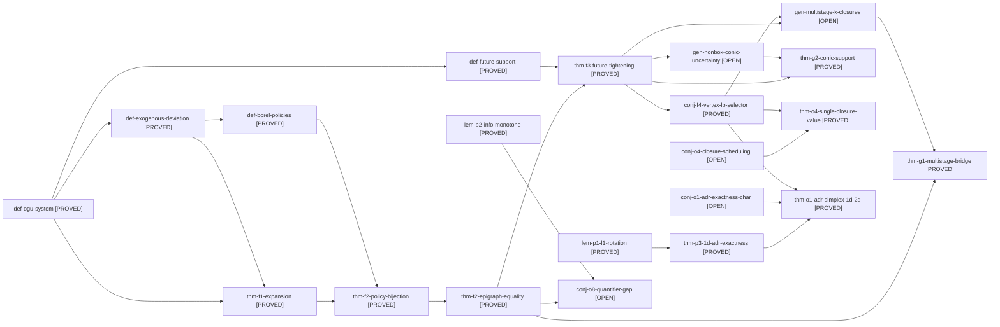

# Lean 4 Blueprint — aro-discovery v2

> Auto-generated from `research/atlas/atlas.json` by `research/atlas/build_atlas.py`.
> Toolchain: `leanprover/lean4:v4.35.0-rc2` | Allowed axioms: `Classical.choice`, `Quot.sound`, `propext`

## Summary

- **Blueprint nodes:** 37 (60 directed edges)
- **Lean 4 kernel-proved nodes:** 16 (55 live-audited declarations)
- **Status breakdown:** `falsified`=8, `lean_proved`=16, `open`=5, `oracle_verified`=8

## Formal Dependency Graph (Lean Core + Open Formalization Frontier)

## Lean 4 Proved Declarations & Formalized Scope

| Blueprint Node | Declaration | Lean Module | Formalized Scope |
|---|---|---|---|
| `def-ogu-system` | `BridgeFormalV2.Proofs.nonempty_blocks` | `verification/lean/BridgeFormalV2/Proofs/Dynamics.lean` | Nonemptiness of ControlBlock and NoiseBlock types for every BridgeFormalV2.Data instance (NonemptyBlocksGoal). |
| `def-exogenous-deviation` | `BridgeFormalV2.Proofs.exogenous_image` | `verification/lean/BridgeFormalV2/Proofs/Dynamics.lean` | ExogenousImageGoal: D.S a = (fun xi => D.nominal a + xi) '' D.Z for every D and first block a. |
| `def-borel-policies` | `BridgeFormalV2.Proofs.observation_fibre` | `verification/lean/BridgeFormalV2/Proofs/Dynamics.lean` | ObservationFibreGoal: equality of observed states prefixState a w1 = prefixState a w2 iff equality of exogenous deviations deviation w1 = deviation w2. |
| `def-future-support` | `BridgeFormalV3.Proofs.attained_support` | `verification/lean/BridgeFormalV3/Proofs/Support.lean` | AttainedSupportGoal: for box NoiseBlock D.q and any linear functional row, row(futureNoiseResponse wp) <= futureRowSupport row and an attaining box corner wp exists. |
| `thm-f1-expansion` | `BridgeFormalV2.Proofs.expansion` | `verification/lean/BridgeFormalV2/Proofs/Dynamics.lean` | ExpansionGoal, PrefixSplitGoal, SourceChronologyGoal, and SuffixExpansionGoal for arbitrary linear maps A, B, E on finite horizon T = r + q. |
| `thm-f1-expansion` | `BridgeFormalV2.Proofs.prefix_split` | `verification/lean/BridgeFormalV2/Proofs/Dynamics.lean` | ExpansionGoal, PrefixSplitGoal, SourceChronologyGoal, and SuffixExpansionGoal for arbitrary linear maps A, B, E on finite horizon T = r + q. |
| `thm-f1-expansion` | `BridgeFormalV2.Proofs.source_chronology` | `verification/lean/BridgeFormalV2/Proofs/Dynamics.lean` | ExpansionGoal, PrefixSplitGoal, SourceChronologyGoal, and SuffixExpansionGoal for arbitrary linear maps A, B, E on finite horizon T = r + q. |
| `thm-f1-expansion` | `BridgeFormalV2.Proofs.suffix_expansion` | `verification/lean/BridgeFormalV2/Proofs/Dynamics.lean` | ExpansionGoal, PrefixSplitGoal, SourceChronologyGoal, and SuffixExpansionGoal for arbitrary linear maps A, B, E on finite horizon T = r + q. |
| `thm-f2-policy-bijection` | `BridgeFormalV2.Proofs.forward_policy` | `verification/lean/BridgeFormalV2/Proofs/Policies.lean` | ForwardPolicyGoal and ReversePolicyGoal: explicit Borel-measurable translation maps preserving trajectories, suffix actions, and guaranteed bounds. |
| `thm-f2-policy-bijection` | `BridgeFormalV2.Proofs.reverse_policy` | `verification/lean/BridgeFormalV2/Proofs/Policies.lean` | ForwardPolicyGoal and ReversePolicyGoal: explicit Borel-measurable translation maps preserving trajectories, suffix actions, and guaranteed bounds. |
| `thm-f2-epigraph-equality` | `BridgeFormalV2.Proofs.epigraph_equality` | `verification/lean/BridgeFormalV2/Proofs/Policies.lean` | EpigraphEqualityGoal: D.sourceLevels = D.aroLevels over Borel-measurable policies for every single-closure BridgeFormalV2.Data instance D. |
| `thm-f3-future-tightening` | `BridgeFormalV3.Proofs.future_expansion` | `verification/lean/BridgeFormalV3/Proofs/Support.lean` | FutureExpansionGoal, RobustRowGoal, and ExactTighteningGoal: exact equivalence AROBound a y eta <-> TightenedAROBound a y eta for box future disturbances. |
| `thm-f3-future-tightening` | `BridgeFormalV3.Proofs.robust_row` | `verification/lean/BridgeFormalV3/Proofs/Support.lean` | FutureExpansionGoal, RobustRowGoal, and ExactTighteningGoal: exact equivalence AROBound a y eta <-> TightenedAROBound a y eta for box future disturbances. |
| `thm-f3-future-tightening` | `BridgeFormalV3.Proofs.exact_tightening` | `verification/lean/BridgeFormalV3/Proofs/Support.lean` | FutureExpansionGoal, RobustRowGoal, and ExactTighteningGoal: exact equivalence AROBound a y eta <-> TightenedAROBound a y eta for box future disturbances. |
| `lem-p1-l1-rotation` | `AroProofs.Aroform.l1_eq_max_sum_diff` | `verification/lean/AroProofs/Aroform.lean` | Exact rational identities l1_eq_max_sum_diff, l2a_diff_two_path, and l2a_sum_two_path over Q. |
| `lem-p1-l1-rotation` | `AroProofs.Aroform.l2a_diff_two_path` | `verification/lean/AroProofs/Aroform.lean` | Exact rational identities l1_eq_max_sum_diff, l2a_diff_two_path, and l2a_sum_two_path over Q. |
| `lem-p1-l1-rotation` | `AroProofs.Aroform.l2a_sum_two_path` | `verification/lean/AroProofs/Aroform.lean` | Exact rational identities l1_eq_max_sum_diff, l2a_diff_two_path, and l2a_sum_two_path over Q. |
| `lem-p2-info-monotone` | `AroProofs.Aroform.info_value_monotone` | `verification/lean/AroProofs/Aroform.lean` | Abstract order-theoretic lemma ∀ {S T : Set ENNReal}, S ⊆ T → sInf T ≤ sInf S (AroProofs.Aroform.info_value_monotone). |
| `thm-p3-1d-adr-exactness` | `AroProofs.Aroform.one_d_exactness` | `verification/lean/AroProofs/Aroform.lean` | 1D scalar rational recourse exactness on [0, 1] (AroProofs.Aroform.one_d_exactness). |
| `conj-f4-vertex-lp-selector` | `AroProofs.BridgeF4VertexLP.borel_right_inverse_exists` | `verification/lean/AroProofs/BridgeF4CornerLP.lean` | Full F4 reduction for every BridgeFormalV2.Data without injectivity of L: explicit Borel right-inverse via lexicographic infimum induction, multilinear corner LP, finiteness of true extreme points vert(Xi), and exact epigraph equalities extremeVertexLPLevels = vertexLPLevels = aroLevels = sourceLevels (9 theorems). |
| `conj-f4-vertex-lp-selector` | `AroProofs.BridgeF4VertexLP.vertex_lp_to_aro` | `verification/lean/AroProofs/BridgeF4CornerLP.lean` | Full F4 reduction for every BridgeFormalV2.Data without injectivity of L: explicit Borel right-inverse via lexicographic infimum induction, multilinear corner LP, finiteness of true extreme points vert(Xi), and exact epigraph equalities extremeVertexLPLevels = vertexLPLevels = aroLevels = sourceLevels (9 theorems). |
| `conj-f4-vertex-lp-selector` | `AroProofs.BridgeF4VertexLP.vertex_lp_epigraph_eq_aro` | `verification/lean/AroProofs/BridgeF4CornerLP.lean` | Full F4 reduction for every BridgeFormalV2.Data without injectivity of L: explicit Borel right-inverse via lexicographic infimum induction, multilinear corner LP, finiteness of true extreme points vert(Xi), and exact epigraph equalities extremeVertexLPLevels = vertexLPLevels = aroLevels = sourceLevels (9 theorems). |
| `conj-f4-vertex-lp-selector` | `AroProofs.BridgeF4VertexLP.vertex_lp_epigraph_eq_source` | `verification/lean/AroProofs/BridgeF4CornerLP.lean` | Full F4 reduction for every BridgeFormalV2.Data without injectivity of L: explicit Borel right-inverse via lexicographic infimum induction, multilinear corner LP, finiteness of true extreme points vert(Xi), and exact epigraph equalities extremeVertexLPLevels = vertexLPLevels = aroLevels = sourceLevels (9 theorems). |
| `conj-f4-vertex-lp-selector` | `AroProofs.BridgeF4VertexLP.zonotopeVertices_finite` | `verification/lean/AroProofs/BridgeF4ExtremeLP.lean` | Full F4 reduction for every BridgeFormalV2.Data without injectivity of L: explicit Borel right-inverse via lexicographic infimum induction, multilinear corner LP, finiteness of true extreme points vert(Xi), and exact epigraph equalities extremeVertexLPLevels = vertexLPLevels = aroLevels = sourceLevels (9 theorems). |
| `conj-f4-vertex-lp-selector` | `AroProofs.BridgeF4VertexLP.extreme_vertex_lp_to_aro` | `verification/lean/AroProofs/BridgeF4ExtremeLP.lean` | Full F4 reduction for every BridgeFormalV2.Data without injectivity of L: explicit Borel right-inverse via lexicographic infimum induction, multilinear corner LP, finiteness of true extreme points vert(Xi), and exact epigraph equalities extremeVertexLPLevels = vertexLPLevels = aroLevels = sourceLevels (9 theorems). |
| `conj-f4-vertex-lp-selector` | `AroProofs.BridgeF4VertexLP.extreme_vertex_lp_epigraph_eq_aro` | `verification/lean/AroProofs/BridgeF4ExtremeLP.lean` | Full F4 reduction for every BridgeFormalV2.Data without injectivity of L: explicit Borel right-inverse via lexicographic infimum induction, multilinear corner LP, finiteness of true extreme points vert(Xi), and exact epigraph equalities extremeVertexLPLevels = vertexLPLevels = aroLevels = sourceLevels (9 theorems). |
| `conj-f4-vertex-lp-selector` | `AroProofs.BridgeF4VertexLP.extreme_vertex_lp_epigraph_eq_source` | `verification/lean/AroProofs/BridgeF4ExtremeLP.lean` | Full F4 reduction for every BridgeFormalV2.Data without injectivity of L: explicit Borel right-inverse via lexicographic infimum induction, multilinear corner LP, finiteness of true extreme points vert(Xi), and exact epigraph equalities extremeVertexLPLevels = vertexLPLevels = aroLevels = sourceLevels (9 theorems). |
| `conj-f4-vertex-lp-selector` | `AroProofs.BridgeF4VertexLP.extreme_vertex_lp_eq_corner_lp` | `verification/lean/AroProofs/BridgeF4ExtremeLP.lean` | Full F4 reduction for every BridgeFormalV2.Data without injectivity of L: explicit Borel right-inverse via lexicographic infimum induction, multilinear corner LP, finiteness of true extreme points vert(Xi), and exact epigraph equalities extremeVertexLPLevels = vertexLPLevels = aroLevels = sourceLevels (9 theorems). |
| `thm-g2-conic-support` | `AroProofs.BridgeG2ConicSupport.general_attained_support` | `verification/lean/AroProofs/BridgeG2ConicSupport.lean` | Stage-wise Minkowski support attainment, exact row and full tightening for arbitrary nonempty compact W_t, F3 box specialization, l1/l2 closed forms, and 2D l2-ball non-polyhedrality (7 theorems). |
| `thm-g2-conic-support` | `AroProofs.BridgeG2ConicSupport.general_robust_row` | `verification/lean/AroProofs/BridgeG2ConicSupport.lean` | Stage-wise Minkowski support attainment, exact row and full tightening for arbitrary nonempty compact W_t, F3 box specialization, l1/l2 closed forms, and 2D l2-ball non-polyhedrality (7 theorems). |
| `thm-g2-conic-support` | `AroProofs.BridgeG2ConicSupport.general_exact_tightening` | `verification/lean/AroProofs/BridgeG2ConicSupport.lean` | Stage-wise Minkowski support attainment, exact row and full tightening for arbitrary nonempty compact W_t, F3 box specialization, l1/l2 closed forms, and 2D l2-ball non-polyhedrality (7 theorems). |
| `thm-g2-conic-support` | `AroProofs.BridgeG2ConicSupport.box_support_eq_f3` | `verification/lean/AroProofs/BridgeG2ConicSupport.lean` | Stage-wise Minkowski support attainment, exact row and full tightening for arbitrary nonempty compact W_t, F3 box specialization, l1/l2 closed forms, and 2D l2-ball non-polyhedrality (7 theorems). |
| `thm-g2-conic-support` | `AroProofs.BridgeG2ConicSupport.l1_cross_polytope_support` | `verification/lean/AroProofs/BridgeG2ConicSupport.lean` | Stage-wise Minkowski support attainment, exact row and full tightening for arbitrary nonempty compact W_t, F3 box specialization, l1/l2 closed forms, and 2D l2-ball non-polyhedrality (7 theorems). |
| `thm-g2-conic-support` | `AroProofs.BridgeG2ConicSupport.l2_soc_ball_support` | `verification/lean/AroProofs/BridgeG2ConicSupport.lean` | Stage-wise Minkowski support attainment, exact row and full tightening for arbitrary nonempty compact W_t, F3 box specialization, l1/l2 closed forms, and 2D l2-ball non-polyhedrality (7 theorems). |
| `thm-g2-conic-support` | `AroProofs.BridgeG2ConicSupport.l2_ball_not_finset_conv_2d` | `verification/lean/AroProofs/BridgeG2ConicSupport.lean` | Stage-wise Minkowski support attainment, exact row and full tightening for arbitrary nonempty compact W_t, F3 box specialization, l1/l2 closed forms, and 2D l2-ball non-polyhedrality (7 theorems). |
| `thm-o4-single-closure-value` | `AroProofs.BridgeO4ClosureValue.openLoop_subset_aro` | `verification/lean/AroProofs/BridgeO4ClosureValue.lean` | Single-closure monotonicity, two zero-gain criteria, shared-corner LP characterization, strict-gain iff corner-separation equivalence, and concrete 4 > 2 witness (7 theorems). |
| `thm-o4-single-closure-value` | `AroProofs.BridgeO4ClosureValue.openLoop_subset_source` | `verification/lean/AroProofs/BridgeO4ClosureValue.lean` | Single-closure monotonicity, two zero-gain criteria, shared-corner LP characterization, strict-gain iff corner-separation equivalence, and concrete 4 > 2 witness (7 theorems). |
| `thm-o4-single-closure-value` | `AroProofs.BridgeO4ClosureValue.zero_gain_of_unconstrained_terminal` | `verification/lean/AroProofs/BridgeO4ClosureValue.lean` | Single-closure monotonicity, two zero-gain criteria, shared-corner LP characterization, strict-gain iff corner-separation equivalence, and concrete 4 > 2 witness (7 theorems). |
| `thm-o4-single-closure-value` | `AroProofs.BridgeO4ClosureValue.zero_gain_of_prefix_in_terminal_kernel` | `verification/lean/AroProofs/BridgeO4ClosureValue.lean` | Single-closure monotonicity, two zero-gain criteria, shared-corner LP characterization, strict-gain iff corner-separation equivalence, and concrete 4 > 2 witness (7 theorems). |
| `thm-o4-single-closure-value` | `AroProofs.BridgeO4ClosureValue.openLoop_eq_shared_corner_lp` | `verification/lean/AroProofs/BridgeO4ClosureValue.lean` | Single-closure monotonicity, two zero-gain criteria, shared-corner LP characterization, strict-gain iff corner-separation equivalence, and concrete 4 > 2 witness (7 theorems). |
| `thm-o4-single-closure-value` | `AroProofs.BridgeO4ClosureValue.strict_gain_iff_corner_separation` | `verification/lean/AroProofs/BridgeO4ClosureValue.lean` | Single-closure monotonicity, two zero-gain criteria, shared-corner LP characterization, strict-gain iff corner-separation equivalence, and concrete 4 > 2 witness (7 theorems). |
| `thm-o4-single-closure-value` | `AroProofs.BridgeO4ClosureValue.exists_strict_value_of_measurement_gap` | `verification/lean/AroProofs/BridgeO4ClosureValue.lean` | Single-closure monotonicity, two zero-gain criteria, shared-corner LP characterization, strict-gain iff corner-separation equivalence, and concrete 4 > 2 witness (7 theorems). |
| `thm-g1-multistage-bridge` | `AroProofs.BridgeG1Multistage.multistage_stage_split` | `verification/lean/AroProofs/BridgeG1Multistage.lean` | Arbitrary-k stage split, causal Borel history-state <-> history-deviation policy translations, exact epigraph equality over arbitrary Omega, Markov inclusion, and k=2 Markov-vs-History separation witness (6 theorems). |
| `thm-g1-multistage-bridge` | `AroProofs.BridgeG1Multistage.multistage_forward_policy` | `verification/lean/AroProofs/BridgeG1Multistage.lean` | Arbitrary-k stage split, causal Borel history-state <-> history-deviation policy translations, exact epigraph equality over arbitrary Omega, Markov inclusion, and k=2 Markov-vs-History separation witness (6 theorems). |
| `thm-g1-multistage-bridge` | `AroProofs.BridgeG1Multistage.multistage_reverse_policy` | `verification/lean/AroProofs/BridgeG1Multistage.lean` | Arbitrary-k stage split, causal Borel history-state <-> history-deviation policy translations, exact epigraph equality over arbitrary Omega, Markov inclusion, and k=2 Markov-vs-History separation witness (6 theorems). |
| `thm-g1-multistage-bridge` | `AroProofs.BridgeG1Multistage.multistage_history_epigraph_eq_aro` | `verification/lean/AroProofs/BridgeG1Multistage.lean` | Arbitrary-k stage split, causal Borel history-state <-> history-deviation policy translations, exact epigraph equality over arbitrary Omega, Markov inclusion, and k=2 Markov-vs-History separation witness (6 theorems). |
| `thm-g1-multistage-bridge` | `AroProofs.BridgeG1Multistage.multistage_markov_subset_history` | `verification/lean/AroProofs/BridgeG1Multistage.lean` | Arbitrary-k stage split, causal Borel history-state <-> history-deviation policy translations, exact epigraph equality over arbitrary Omega, Markov inclusion, and k=2 Markov-vs-History separation witness (6 theorems). |
| `thm-g1-multistage-bridge` | `AroProofs.BridgeG1Multistage.exists_markov_strictly_weaker_than_history_k2` | `verification/lean/AroProofs/BridgeG1Multistage.lean` | Arbitrary-k stage split, causal Borel history-state <-> history-deviation policy translations, exact epigraph equality over arbitrary Omega, Markov inclusion, and k=2 Markov-vs-History separation witness (6 theorems). |
| `thm-o1-adr-simplex-1d-2d` | `AroProofs.BridgeO1ADRExactness.static_subset_adr_subset_aro` | `verification/lean/AroProofs/BridgeO1ADRExactness.lean` | General fixed-recourse inclusion, d-simplex ADR exactness, barycentric-syzygy coupling, T3 gap (1 vs >= 3), universal 1D BridgeFormalV2 ADR exactness, and concrete 2D strict gap witness 6 vs >= 8 (7 theorems). |
| `thm-o1-adr-simplex-1d-2d` | `AroProofs.BridgeO1ADRExactness.adr_exact_on_simplex` | `verification/lean/AroProofs/BridgeO1ADRExactness.lean` | General fixed-recourse inclusion, d-simplex ADR exactness, barycentric-syzygy coupling, T3 gap (1 vs >= 3), universal 1D BridgeFormalV2 ADR exactness, and concrete 2D strict gap witness 6 vs >= 8 (7 theorems). |
| `thm-o1-adr-simplex-1d-2d` | `AroProofs.BridgeO1ADRExactness.barycentric_syzygy_adr_coupling` | `verification/lean/AroProofs/BridgeO1ADRExactness.lean` | General fixed-recourse inclusion, d-simplex ADR exactness, barycentric-syzygy coupling, T3 gap (1 vs >= 3), universal 1D BridgeFormalV2 ADR exactness, and concrete 2D strict gap witness 6 vs >= 8 (7 theorems). |
| `thm-o1-adr-simplex-1d-2d` | `AroProofs.BridgeO1ADRExactness.chen_zhang_t3_adr_gap` | `verification/lean/AroProofs/BridgeO1ADRExactness.lean` | General fixed-recourse inclusion, d-simplex ADR exactness, barycentric-syzygy coupling, T3 gap (1 vs >= 3), universal 1D BridgeFormalV2 ADR exactness, and concrete 2D strict gap witness 6 vs >= 8 (7 theorems). |
| `thm-o1-adr-simplex-1d-2d` | `AroProofs.BridgeO1ADRExactness.bridge_adr_subset_aro_and_source` | `verification/lean/AroProofs/BridgeO1ADRExactness.lean` | General fixed-recourse inclusion, d-simplex ADR exactness, barycentric-syzygy coupling, T3 gap (1 vs >= 3), universal 1D BridgeFormalV2 ADR exactness, and concrete 2D strict gap witness 6 vs >= 8 (7 theorems). |
| `thm-o1-adr-simplex-1d-2d` | `AroProofs.BridgeO1ADRExactness.bridge_adr_exact_1d` | `verification/lean/AroProofs/BridgeO1ADRExactness.lean` | General fixed-recourse inclusion, d-simplex ADR exactness, barycentric-syzygy coupling, T3 gap (1 vs >= 3), universal 1D BridgeFormalV2 ADR exactness, and concrete 2D strict gap witness 6 vs >= 8 (7 theorems). |
| `thm-o1-adr-simplex-1d-2d` | `AroProofs.BridgeO1ADRExactness.exists_bridge_2d_strict_adr_gap` | `verification/lean/AroProofs/BridgeO1ADRExactness.lean` | General fixed-recourse inclusion, d-simplex ADR exactness, barycentric-syzygy coupling, T3 gap (1 vs >= 3), universal 1D BridgeFormalV2 ADR exactness, and concrete 2D strict gap witness 6 vs >= 8 (7 theorems). |

## Open Formalization Targets (Stage 2 -> Stage 3 Queue)

| Target Node | Kind | Dependencies | Refuting Boundaries | ADR Constraints |
|---|---|---|---|---|
| `conj-o4-closure-scheduling` | `open_conjecture` | `lem-wave5-support-bound`, `thm-m0-finite-bellman` | — | — |
| `conj-o1-adr-exactness-char` | `open_conjecture` | `thm-t1-bridge-exact`, `thm-t6-box-static-exact`, `thm-t7-simplex-exact` | `ce-t2-soc-temporal`, `ce-t3-chen-zhang`, `ce-t4-gtw25-cond-b`, `ce-t5-beg18-separating` | — |
| `conj-o8-quantifier-gap` | `open_conjecture` | `lem-p2-info-monotone`, `thm-f2-epigraph-equality` | — | — |
| `gen-multistage-k-closures` | `generalization_target` | `conj-f4-vertex-lp-selector`, `thm-f3-future-tightening` | `ce-d1-prefix-merge`, `ce-d2-pairwise-vs-joint` | — |
| `gen-nonbox-conic-uncertainty` | `generalization_target` | `thm-f3-future-tightening` | — | `ce-t2-soc-temporal`, `ce-t3-chen-zhang` |
